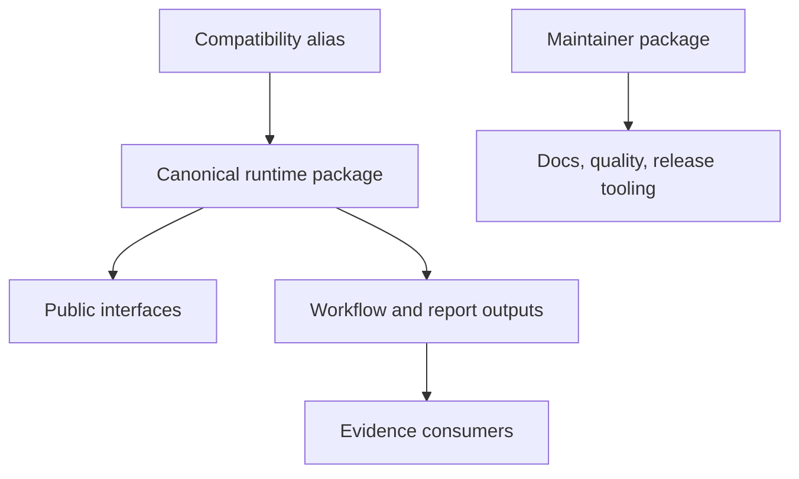

# Runtime Architecture

This section explains how the runtime is organized so capability claims stay
readable and package ownership stays explicit.

## Design Priorities

- one canonical runtime package
- one thin compatibility distribution
- a clear split between runtime, evidence, and maintainer tooling
- capability families grouped by durable responsibility rather than by delivery
  history
- governed artifacts instead of ad hoc local output layouts

## Architectural Promise

The architecture is organized so public capability claims remain traceable:

- package roles stay explicit instead of hiding runtime, evidence, and
  maintainer concerns in one surface
- capability families group by durable scientific responsibility rather than
  by temporary delivery history
- evidence consumers read governed outputs from the runtime without turning the
  evidence-book into a shadow runtime layer

## Questions This Section Answers

- which package should I install or depend on
- Which runtime family owns a capability?
- Which package owns the runtime story?
- Where does native ownership end and wrapper orchestration begin?
- How does the evidence book consume runtime outputs without becoming the
  runtime itself?

## Read Next

- [Runtime system map](runtime-system-map.md)
- [Package map](package-map.md)
- [Evidence consumer boundary](evidence-consumer-boundary.md)
