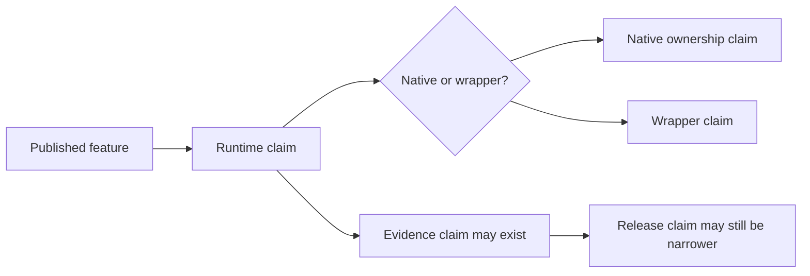

# Claim Reading Guide

This repository publishes different kinds of claim. They should not be read as
synonyms.

## Claim Types

- runtime claim
  A documented feature is part of the public runtime surface.
- native ownership claim
  The named feature is implemented locally rather than only delegated to an
  external engine.
- wrapper claim
  An external-engine workflow is intentionally published as a governed product
  surface without being described as native.
- evidence claim
  Governed studies, parity cases, or benchmark lanes support a bounded trust
  statement.
- release claim
  Docs, metadata, readiness reports, and evidence boundaries align closely
  enough for a publishable repository story.

## Reading Rule

Do not convert one claim type into another automatically.

- A documented runtime surface is not automatically evidence-closed.
- a documented runtime surface is not automatically evidence-closed
- A native implementation is not automatically broader than its documented
  contract.
- A wrapper-backed workflow can still be a real product surface.
- One study does not close an entire runtime family.
- One green release gate does not erase bounded evidence limits.

## Practical Examples

- Native maximum-likelihood result objects are runtime claims and native
  ownership claims.
- FASTA-to-tree orchestration can be a runtime claim with wrapper ownership.
- The evidence book records whether those surfaces have bounded study or parity
  support.
- Release-readiness reports judge whether the repository tells that full story
  coherently at one release point.

## Read Alongside

- [Runtime and evidence boundary](evidence-boundary.md)
- [Product surface and ownership](product-surface-and-ownership.md)
- [Validation lanes](../quality/validation-lanes.md)
- [Evidence Book](../../phylogenetics-evidence-book/index.md)
