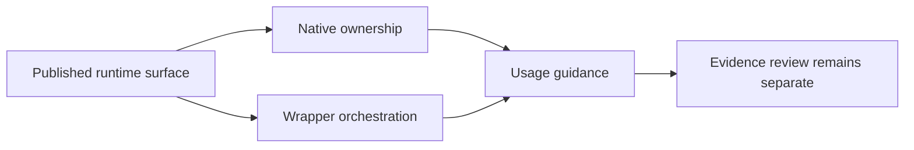

# What This Runtime Is For

`bijux-phylogenetics` is a reproducible runtime for phylogenetic inspection,
comparison, annotation, comparative analysis, ancestral reconstruction,
native likelihood and inference, and governed reporting.

Its value is not that it replaces every upstream engine. Its value is that it
makes important phylogenetic work inspectable, repeatable, and reviewable
through one documented product surface.

## Core Responsibilities

- tree validation, rooting, comparison, rendering, and tree-set review
- alignment diagnostics, trimming, coding checks, and translation
- native finite-state likelihood, native maximum-likelihood inference, and
  supported native Bayesian inference surfaces
- comparative analysis and ancestral-state reconstruction
- wrapper orchestration for selected external scientific tools
- report, bundle, and artifact generation for downstream review

## Why This Runtime Matters

The repository is useful because it combines three things that often stay
split across separate projects:

- owned runtime semantics for trees, alignments, and comparative workflows
- practical workflow entry points for users who need end-to-end execution
- reviewer-facing artifacts and evidence boundaries for readers who need to
  inspect what happened

## What This Handbook Will Not Do

- describe every external workflow as if it were a native implementation
- imply that every documented feature is already evidence-closed
- flatten scientific review into a single success label
- substitute repository-health rules for user-facing runtime guidance

## How To Read The Boundary

The runtime can be broader than the currently closed evidence surface. That is
acceptable only when the documentation says so plainly and routes readers to
the right trust surface.

Use the claim reading guide when you need that distinction spelled out
explicitly.

## Continue With

- [Claim reading guide](claim-reading-guide.md)
- [Repository scope and limits](repository-scope-and-limits.md)
- [Product surface and ownership](product-surface-and-ownership.md)
- [Runtime and evidence boundary](evidence-boundary.md)
