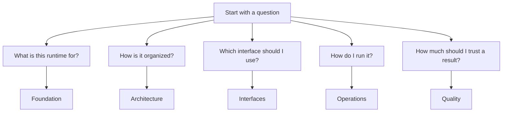

# Bijux Phylogenetics Product Guide

This handbook explains the public runtime: what it is for, which interfaces
are stable, how to operate it locally, and how to read its quality limits
without over-claiming.

Use this handbook when you want the product answer first rather than the
source-tree answer first.

  <a class="md-button md-button--primary" href="../../index.md">Documentation home</a>
  <a class="md-button" href="foundation/">Runtime purpose and scope</a>
  <a class="md-button" href="architecture/">Architecture and package roles</a>
  <a class="md-button" href="interfaces/">Public interfaces</a>
  <a class="md-button" href="operations/">Installation and workflows</a>
  <a class="md-button" href="quality/">Quality and release limits</a>

## What This Handbook Covers

- the runtime scope, ownership model, and non-goals
- package and interface boundaries
- installation, workflow, and native-use entry points
- how evidence, benchmarks, and release gates should be read
- where public usage guidance ends and maintainer guidance begins

## Runtime Capability Map

| Question area | Where the handbook goes deep |
| --- | --- |
| Runtime purpose | ownership, scope, and evidence boundaries |
| Runtime architecture | package roles, system map, and evidence-consumer boundary |
| Public interfaces | CLI, workflow API, native Python, artifacts, and benchmark surfaces |
| Practical operation | installation, common workflows, native ML, native Bayesian, and benchmark review |
| Trust and quality | validation lanes, benchmark interpretation, release review, and claim honesty |

## Why Readers Should Not Underestimate This Runtime

The public runtime is broader than a simple workflow wrapper. It includes:

- owned tree and topology semantics reused across comparison, support, and
  reporting workflows
- native finite-state likelihood families and native inference result objects
- typed Python workflow contracts that emit durable reviewer-facing artifacts
- governed benchmark and evidence-linked review surfaces that keep the release
  story inspectable

## Read By Question

- What is this repository trying to do, and what is it not trying to claim?
  Start with [Foundation](foundation/index.md).
- Which package or subsystem owns a capability?
  Start with [Architecture](architecture/index.md).
- Which entry point should I use for my task?
  Start with [Interfaces](interfaces/index.md).
- How do I install the runtime and run practical workflows?
  Start with [Operations](operations/index.md).
- How do I judge trust, release posture, and limits?
  Start with [Quality](quality/index.md).

## Flagship Guides

- [Surface selection guide](interfaces/surface-selection.md)
- [Native maximum-likelihood workflows](operations/native-maximum-likelihood-workflows.md)
- [Native Bayesian workflows](operations/native-bayesian-workflows.md)
- [Native benchmark review](operations/native-benchmark-review.md)
- [Validation lanes](quality/validation-lanes.md)
- [Claim reading guide](foundation/claim-reading-guide.md)

## Related Reading

- Use the [Evidence Book](../phylogenetics-evidence-book/index.md) when the
  question is study evidence, parity, freshness, or coverage gaps.
- Use the [Maintainer guide](../phylogenetics-maintainer/index.md) when the
  question is release stewardship, documentation alignment, or repository
  health.
