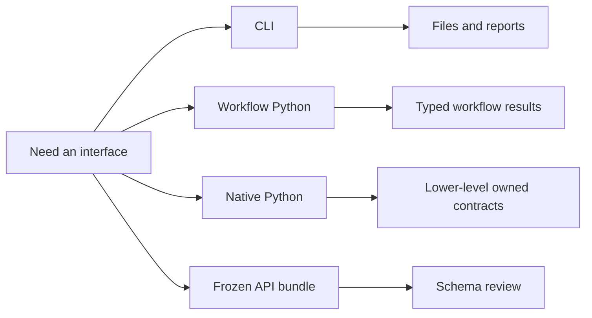

# Public Interfaces

This section describes the runtime contracts that readers are expected to use
directly.

## Interface Families

- CLI commands for end-to-end workflows and reviewer-facing files
- workflow Python surfaces under `bijux_phylogenetics.api`
- native Python contracts for runtime objects and inference results
- benchmark and evidence-adjacent runtime contracts
- emitted artifact and report families

## Start Here

- If you need help choosing an entry point, use the
  [surface selection guide](surface-selection.md).
- If you already know the entry point, continue to the matching reference
  page below.

## Section Map

- [Surface selection guide](surface-selection.md)
- [CLI surface](cli-surface.md)
- [API surface](api-surface.md)
- [Python surface](python-surface.md)
- [Native inference and benchmarks](native-inference-and-benchmarks.md)
- [Artifact consumption guide](artifact-consumption-guide.md)
- [Artifact contracts](artifact-contracts.md)

The surface selection guide and artifact consumption guide are the two fastest
ways to orient a new reader before they drop into the larger CLI and Python
reference pages.
