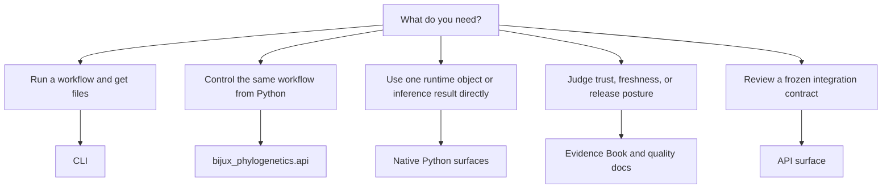

# Surface Selection Guide

Use this page when you know what you want to do, but you are not sure which
public entry point to start with.

The project exposes several public routes on purpose. They answer different
questions: some help you run a full workflow, some help you control that
workflow from Python, and some help you judge whether the result is trustworthy
enough for your use case.

## Start With Your Goal

- I want one governed end-user workflow or report artifact
  Start with the CLI.
- I want the same governed workflow behavior inside Python code
  Start with `bijux_phylogenetics.api`.
- I want one owned native runtime object or inference contract directly
  Start with the named Python native surfaces.
- I want to judge trust, parity, freshness, or evidence closure
  Start with the evidence-book and quality docs.
- I want a frozen integration contract rather than one live runtime process
  Start with the checked-in API bundle.

## Pick The Right Entry Point

### CLI

Choose the CLI when you want:

- a command you can run from the shell
- reviewer-facing files such as HTML, JSON, SVG, or TSV outputs
- the documented workflow defaults instead of wiring each step yourself
- release-facing command surfaces such as `benchmark` or `report release-truth`

Start from [CLI surface](cli-surface.md).

### Workflow Python

Choose `bijux_phylogenetics.api` when you want:

- notebook or pipeline control
- typed workflow results
- the same report fields the CLI writes
- stable `write_json(...)` or `write_tsv(...)` helpers around workflow outputs

Start from [API surface](api-surface.md) and [Python surface](python-surface.md).

### Native Python

Choose the named native Python surfaces when you want:

- one owned in-memory runtime object such as `PhyloTree`
- one native maximum-likelihood result contract
- one native Bayesian run contract
- one benchmark report contract

Start from [native inference and benchmarks](native-inference-and-benchmarks.md)
and [Python surface](python-surface.md).

### Evidence And Trust

Choose the evidence-book and quality guides when you want:

- freshness and integrity status
- benchmark interpretation
- release readiness
- bounded claim review instead of only runtime usage guidance

Start from [Evidence Book](../../phylogenetics-evidence-book/index.md),
[native benchmark evidence](../quality/native-benchmark-evidence.md), and
[release review workflow](../quality/release-review-workflow.md).

### Frozen API Bundle

Choose the checked-in API bundle when you want:

- one reviewable schema contract
- one pinned OpenAPI surface
- integration planning without assuming a live hosted service

Start from [API surface](api-surface.md).

## Practical Rules

- If the result should be one file bundle you can review or share, prefer the
  CLI.
- If the result should be one typed workflow object inside Python, prefer
  `bijux_phylogenetics.api`.
- If the result should be one lower-level runtime contract rather than one full
  workflow wrapper, prefer the named native Python surfaces.
- If the question is whether the repository has proved something, leave the
  runtime handbook and read the evidence or quality surfaces directly.

## What Not To Do

- Do not assume every internal helper is a public contract.
- Do not treat wrapper-backed workflows as if they were native implementation
  surfaces.
- Do not use the evidence-book as a substitute for runtime usage docs.
- Do not use one runtime page as proof of scientific closure.
