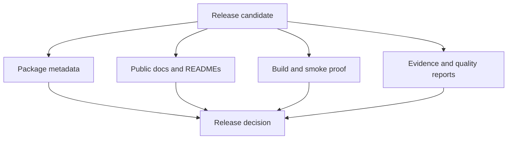

# Release And Publication Gates

Release readiness is earned, not assumed.

Before this project claims a clean release state, it checks package metadata,
shared standards sync, build proof, evidence-governance rules, and
publication-readiness reports together.

That matters here because runtime breadth and evidence closure do not always
move at the same speed. A trustworthy release has to describe both honestly.

## Questions A Release Must Answer

- do the documented public packages, READMEs, and handbook pages describe the
  runtime truthfully
- do package metadata, release descriptions, and public docs describe the same
  product surface
- do native inference and benchmark claims stay bounded by explicit runtime
  contracts rather than by implication
- do wrapper-backed workflows remain clearly labeled as wrapper orchestration
  when that is still the honest boundary
- do publication-readiness and evidence-governance reports stay green on the
  repository state being released

## What A Reader Should Look For

Release readiness here is not one badge and not one green test lane.

The serious release story has to hold across:

- package metadata
- root and package READMEs
- public and maintainer docs
- package build verification
- release-readiness and publish-readiness reports
- runtime, parity, benchmark, and evidence-governance surfaces

## Governed Release Surfaces

The main repository-level readiness commands are:

- `make report-publish-readiness`
- `make check-publish-readiness`
- `make report-release-readiness`
- `make check-release-readiness`

The main runtime-level pre-release summary surface is:

- `bijux-phylogenetics report release-truth ...`

Use the practical guide in
[release review workflow](release-review-workflow.md) for how those surfaces
fit together during one serious release audit.

## Failure Patterns To Reject

The release state should be treated as weak, even if some checks are green,
when any of these remain true:

- docs say more than metadata
- metadata says more than evidence
- benchmark or native claims are broader than the documented runtime contract
- wrapper-backed surfaces are described as if they were native ownership
- evidence freshness or coverage gaps are hidden behind generic release wording
