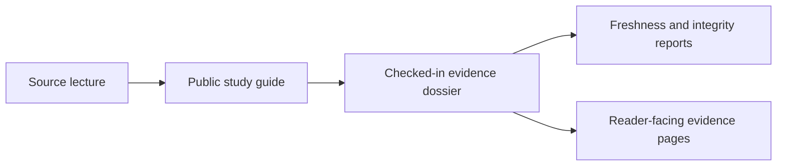

# Evidence Book

This section helps you read the comparative study record that sits behind the
public phylogenetics runtime.

The five study families come from course material that the repository has been
turning into checked-in, reviewable evidence. Some study slices are already
reproduced in governed bundles. Others are documented clearly, but still stop
at a study dossier or an external-tool boundary.

## Start Here

- [evidence book reading guide](reading-guide.md)
- checked-in study dossiers:
  [`evidence-book/README.md`](https://github.com/bijux/bijux-phylogenetics/blob/main/evidence-book/README.md)
- repository-wide review reports:
  [`evidence-book/index/`](https://github.com/bijux/bijux-phylogenetics/tree/main/evidence-book/index)

Treat those checked-in reports as the current source of truth when you need
live repository status rather than the stable narrative on this page.

## Study Atlas

| Study | Main question | Current repository state |
| --- | --- | --- |
| [PCM1: primate longevity signal](pcm1-primate-longevity-signal/index.md) | How do raw primate traits and trees become a usable comparative dataset, signal estimate, and ancestral reconstruction? | Governed parity deployed |
| [PCM2: primate PGLS and signal](pcm2-primate-pgls-and-signal/index.md) | How do transformed trees, comparative model fitting, PGLS, and diagnostics behave on the same primate system? | Governed parity deployed |
| [PCM3: primate continuous and categorical regression](pcm3-primate-continuous-and-categorical-regression/index.md) | How should multivariable regression, categorical predictors, interactions, and phylogenetic correction be interpreted together? | Study dossier deployed; lecture parity not yet packaged as governed bundles |
| [PCM4: cichlid Bayesian linear and phylogenetic mixed models](pcm4-cichlid-bayesian-linear-and-phylogenetic-mixed-models/index.md) | How does the workflow move from Gaussian regression to Bayesian mixed models with a phylogenetic random effect? | Study dossier deployed; core posterior workflow still external |
| [PCM5: cichlid phylogenetic generalized linear mixed models](pcm5-cichlid-phylogenetic-generalized-linear-mixed-models/index.md) | How are count models, binomial-style models, posterior signal estimates, and repeated measures handled together? | Study dossier deployed; core posterior workflow still external |

## What Each Study Page Does

Each study page does three jobs:

- explain the analytical story in plain language
- point to the checked-in evidence dossier under `evidence-book/studies/`
- state clearly whether the repository already reproduces the lecture or is
  still documenting an external boundary

## How To Use This Section

Use these study pages when you want to know:

- what a given lecture family is trying to show
- which repository surfaces have already been checked against that lecture
- where a study remains documented but not yet fully reproduced

Use the main phylogenetics handbook when you need:

- how to install or run the package
- which API or CLI surfaces are public
- how native and wrapper-backed runtime families are organized
