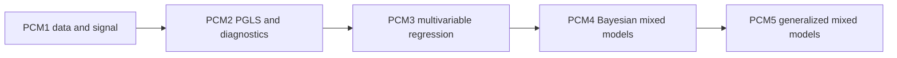

# Evidence Book Reading Guide

Use this section when you want to read the comparative case studies as studies:
what question each one asks, what the repository already reproduces, and where
important limits still remain.

## Choose A Starting Point

- Start with PCM1 if you want the full preparation path from raw primate traits
  and tree files to signal estimation and ancestral reconstruction.
- Continue to PCM2 if you want to see how the same primate system behaves under
  GLS, PGLS, transformed trees, and signal testing.
- Read PCM3 if your main question is regression interpretation: standardized
  predictors, categorical predictors, and interactions.
- Read PCM4 and PCM5 together if you are interested in the cichlid mixed-model
  lectures, because they share the same dataset and the same posterior-sampling
  dependency.

## Core Reading Order

For a serious first pass through the course-derived studies, read:

1. `overview`
2. `PCM1`
3. `PCM2`
4. `PCM3`
5. `PCM4`
6. `PCM5`

That order mirrors the course progression. It starts with data and tree
preparation, moves through comparative regression, and ends with the cichlid
mixed-model lectures where the repository depends most heavily on external
posterior tooling.

## How To Read A Study Page

Each study guide is meant to answer four reader questions quickly:

- What is the lecture family trying to show?
- Which parts already have governed parity bundles or bounded parity evidence?
- Which parts still keep verdicts open instead of claiming full reproduction?
- Where should I go next if I need the underlying checked-in record?

## When To Leave These Pages

- Leave for the main phylogenetics handbook when you need installation,
  commands, or runtime entry points rather than study interpretation.
- Leave for the checked-in study record in
  [`evidence-book/README.md`](https://github.com/bijux/bijux-phylogenetics/blob/main/evidence-book/README.md)
  when you need dataset registries, provenance, or bundle-level reports.
- Leave for
  [`evidence-book/index/`](https://github.com/bijux/bijux-phylogenetics/tree/main/evidence-book/index)
  when you need freshness, integrity, coverage, or repository-wide review
  status.

## What These Pages Deliberately Do Not Do

- They do not claim that every lecture has already been reproduced end to end.
- They do not hide external-tool dependencies just because nearby Python
  surfaces exist in the repository.
- They do keep those limits visible, especially for PCM4 and PCM5.
