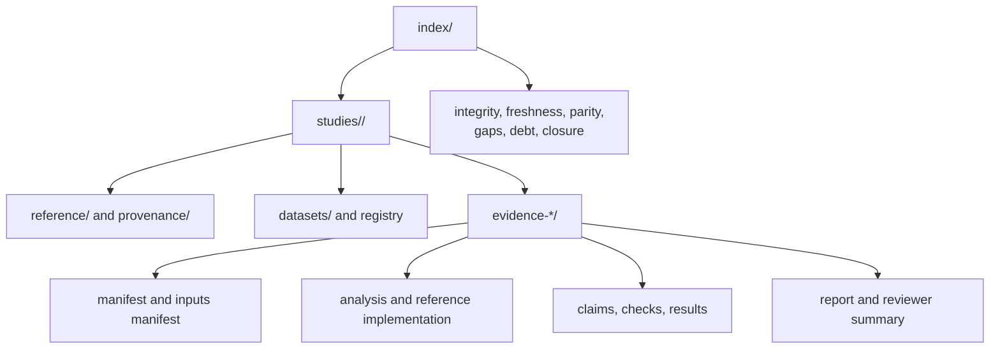

# Evidence Book

This directory contains the primary, checked-in record for governed
phylogenetic study claims. It connects scientific sources to identified inputs,
executable analyses, checks, results, reviewer summaries, and repository-wide
verdict indexes.

## Directory Model

## Start Here

| Need | Open |
| --- | --- |
| understand available studies and bundle inventory | [`index/catalog.md`](index/catalog.md) |
| locate claims and bundles programmatically | [`index/evidence-index.json`](index/evidence-index.json) |
| see current integrity state | [`index/integrity-report.md`](index/integrity-report.md) |
| identify stale evidence | [`index/freshness-report.md`](index/freshness-report.md) |
| review parity verdicts | [`index/parity-dashboard.md`](index/parity-dashboard.md) |
| find incomplete coverage | [`index/coverage-gaps.md`](index/coverage-gaps.md) |
| understand closure requirements | [`index/closure-criteria.md`](index/closure-criteria.md) |

The public [Evidence Book guide](../docs/03-bijux-phylogenetics-evidence-book/index.md)
provides the scientific reading route. This directory remains the primary
record when narrative and generated status differ.

## Bundle Anatomy

Each `evidence-*` directory is a bounded review unit. Its exact files vary, but
the contract separates:

- `manifest.json`: bundle identity, relationships, and execution metadata;
- `inputs.manifest.json`: identified inputs and material dependencies;
- `provenance.json`: source lineage and attribution;
- `claims.json`: claims evaluated by the bundle;
- `checks.json`: assertions, metrics, tolerances, and verdict inputs;
- `analysis.py` and `reference.R`: compared executable paths where applicable;
- `results/`: machine-readable observations and reviewer summaries;
- `report.md`: contextual explanation, not a substitute for structured state.

Do not infer success from the directory name or from analysis completion. Read
the claim verdict and the current repository indexes.

## Study Families

| Directory | Focus |
| --- | --- |
| `primate-longevity-signal` | tree/data preparation, signal, and ancestral results |
| `primate-pgls-and-signal` | GLS, PGLS, tree transformations, and signal diagnostics |
| `primate-continuous-and-categorical-regression` | continuous and categorical comparative regression |
| `cichlid-bayesian-linear-and-phylogenetic-mixed-models` | Bayesian mixed-model study sequence |
| `cichlid-phylogenetic-generalized-linear-mixed-models` | generalized mixed models and posterior signal |

## Verdict Discipline

Verdicts are claim-scoped:

- `pass` means the declared acceptance rule was met;
- `fail` means a required check was not met;
- `open` means evidence is incomplete or inconclusive;
- `blocked` means a named dependency prevents closure.

A passing bundle does not cause neighboring claims to pass. An open external
posterior boundary does not erase valid preparation or contract evidence.

## Freshness And Integrity

Integrity answers whether the declared record is coherent. Freshness answers
whether it still corresponds to material code, inputs, configuration, and
sources. A structurally valid old bundle may be stale. Review both reports
before citing a verdict as current.

## Contribution Rules

1. Start from a bounded claim and explicit closure criterion.
2. Register source provenance and datasets before asserting results.
3. Keep compared configurations and conventions visible.
4. Store machine-readable checks and results; do not encode verdicts only in
   prose.
5. Preserve failures, exclusions, and external dependencies.
6. Regenerate and review repository-wide indexes with the supported maintainer
   tooling.
7. Commit generated index changes separately from handwritten scientific
   interpretation when they represent distinct review intents.

## Non-Claims

This directory is not a claim that every runtime method has study evidence,
that every course analysis is reproduced end to end, or that passing parity
settles model choice and biological interpretation. It is a governed map of
what has been checked and what remains open.
