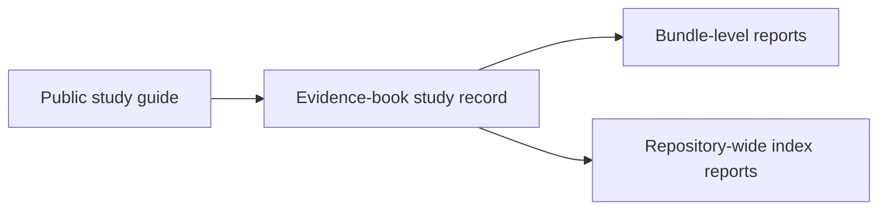

# Evidence Book

This directory is the checked-in study record for `bijux-phylogenetics`.
It shows which comparative case studies are represented in the repository,
which governed bundle-level checks already exist, and where important
analytical limits still remain.

Use this directory for durable review. Use `artifacts/` for local scratch runs
and temporary outputs that should not become part of the checked-in record.

## Start In Two Layers

- Reader-facing study guides live under
  [`docs/public/phylogenetics-evidence-book/`](../docs/public/phylogenetics-evidence-book/)
- Checked-in study records, datasets, and provenance live under
  [`studies/`](./studies/)

The public guides explain the scientific story. The `studies/` directories hold
the durable repository record that backs those guides.

All five PCM study families now carry governed parity `evidence-###` bundles
in the repository. What still differs from study to study is the
verdict depth: PCM1 and PCM2 already carry stronger checked-in numerical parity
records, while PCM3 to PCM5 deploy the same durable bundle structure with
explicitly open lecture or posterior boundaries.

## Study Catalog

| Study | Lecture family | Evidence IDs | Current checked-in state |
| --- | --- | --- | --- |
| [`primate-longevity-signal`](./studies/primate-longevity-signal/) | PCM1 plots, signal, and ancestral reconstruction | `evidence-001` to `evidence-009` | Governed parity bundles deployed; plotting surfaces remain outside the numeric parity claim |
| [`primate-pgls-and-signal`](./studies/primate-pgls-and-signal/) | PCM2 evolutionary modes, PGLS, and signal testing | `evidence-001` to `evidence-010` | Governed parity bundles deployed; one explicit coverage boundary remains open |
| [`primate-continuous-and-categorical-regression`](./studies/primate-continuous-and-categorical-regression/) | PCM3 multivariable regression with categorical predictors and interactions | `evidence-001` to `evidence-008` | Governed parity bundles deployed; lecture-specific verdicts remain open |
| [`cichlid-bayesian-linear-and-phylogenetic-mixed-models`](./studies/cichlid-bayesian-linear-and-phylogenetic-mixed-models/) | PCM4 Bayesian linear models and phylogenetic mixed models | `evidence-001` to `evidence-007` | Governed parity bundles deployed; posterior engine remains external |
| [`cichlid-phylogenetic-generalized-linear-mixed-models`](./studies/cichlid-phylogenetic-generalized-linear-mixed-models/) | PCM5 phylogenetic generalized linear mixed models | `evidence-001` to `evidence-009` | Governed parity bundles deployed; posterior engine remains external |

## Repository-Wide Reports

These index pages remain the repository-wide review surfaces:

- Teaching and migration landing page:
  [`index/teaching-and-migration.md`](./index/teaching-and-migration.md)
- Freshness tracking:
  [`index/freshness-report.md`](./index/freshness-report.md)
- Integrity tracking:
  [`index/integrity-report.md`](./index/integrity-report.md)
- Coverage gaps:
  [`index/coverage-gaps.md`](./index/coverage-gaps.md)
- Claim re-audit:
  [`index/claim-reaudit.md`](./index/claim-reaudit.md)
- Analytical surface coverage:
  [`index/analytical-surface-coverage.md`](./index/analytical-surface-coverage.md)
- Closure criteria:
  [`index/closure-criteria.md`](./index/closure-criteria.md)
- Maturity scorecard:
  [`index/evidence-maturity-scorecard.md`](./index/evidence-maturity-scorecard.md)
- Completion gates:
  [`index/completion-gates.md`](./index/completion-gates.md)

## How To Use This Directory

- Start with the study README that matches the lecture family you care about.
- Confirm which `evidence-###` range belongs to that study family.
- Follow its dataset registry, source provenance, and bundle-level reports.
- Move to the index reports when you need repository-wide status rather than one
  study family.

## What This Directory Does Not Claim

- It does not claim that every documented study is already reproduced end to
  end inside the repository.
- It does not treat a checked-in governed parity bundle ID as equivalent to a
  matched lecture verdict.
- It does keep those differences explicit so readers can see where the evidence
  is strong and where work remains.
