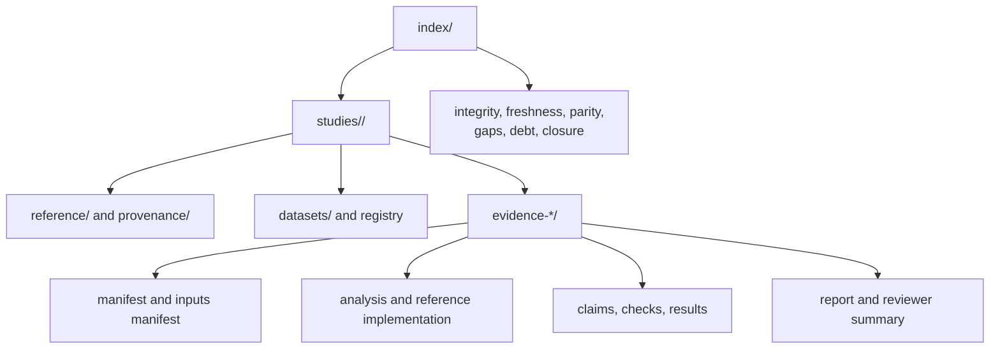

# Evidence Book

This directory contains the primary, checked-in record for governed
phylogenetic study claims. It connects scientific sources to identified inputs,
executable analyses, checks, results, reviewer summaries, and repository-wide
verdict indexes.

## Directory Model

## Start Here

| Need | Open |
| --- | --- |
| understand available studies and bundle inventory | [`index/catalog.md`](index/catalog.md) |
| locate claims and bundles programmatically | [`index/evidence-index.json`](index/evidence-index.json) |
| see current integrity state | [`index/integrity-report.md`](index/integrity-report.md) |
| identify stale evidence | [`index/freshness-report.md`](index/freshness-report.md) |
| review parity verdicts | [`index/parity-dashboard.md`](index/parity-dashboard.md) |
| find incomplete coverage | [`index/coverage-gaps.md`](index/coverage-gaps.md) |
| understand closure requirements | [`index/closure-criteria.md`](index/closure-criteria.md) |

The public [Evidence Book guide](../docs/03-bijux-phylogenetics-evidence-book/index.md)
provides the scientific reading route. This directory remains the primary
record when narrative and generated status differ.

## Bundle Anatomy

Each `evidence-*` directory is a bounded review unit. Its exact files vary, but
the contract separates:

- `manifest.json`: bundle identity, relationships, and execution metadata;
- `inputs.manifest.json`: identified inputs and material dependencies;
- `provenance.json`: source lineage and attribution;
- `claims.json`: claims evaluated by the bundle;
- `checks.json`: assertions, metrics, tolerances, and verdict inputs;
- `analysis.py` and `reference.R`: compared executable paths where applicable;
- `results/`: machine-readable observations and reviewer summaries;
- `report.md`: contextual explanation, not a substitute for structured state.

Do not infer success from the directory name or from analysis completion. Read
the claim verdict and the current repository indexes.

## Study Families

| Directory | Focus |
| --- | --- |
| `primate-longevity-signal` | tree/data preparation, signal, and ancestral results |
| `primate-pgls-and-signal` | GLS, PGLS, tree transformations, and signal diagnostics |
| `primate-continuous-and-categorical-regression` | continuous and categorical comparative regression |
| `cichlid-bayesian-linear-and-phylogenetic-mixed-models` | Bayesian mixed-model study sequence |
| `cichlid-phylogenetic-generalized-linear-mixed-models` | generalized mixed models and posterior signal |

## Verdict Discipline

Bundle verdicts are claim-scoped and use the governed vocabulary stored in
each `manifest.json`:

| Verdict | Meaning |
| --- | --- |
| `matched` | every claim-required comparable observation satisfies the registered exact or structural rule |
| `matched_with_tolerance` | every claim-required comparable observation satisfies the predeclared numerical rule |
| `mismatch_explained` | a comparable difference exists with a governed cause and consequence |
| `mismatch_unexplained` | a comparable difference violates its rule without an accepted explanation |
| `not_comparable` | required estimand, identity, execution, or output alignment is unavailable |

Execution states such as failed, partial, blocked, or complete belong to run
records. Open follow-through belongs to the resolution workflow. Neither is a
sixth bundle verdict, and neither may replace the verdict recorded by the
manifest.

A matched bundle does not cause neighboring claims to match. A
`not_comparable` posterior claim is not a numerical failure and not partial
credit: it preserves exactly why no valid comparison is currently owned.

## Read The Evidence Population, Not A Headline

The checked-in revision contains 43 bundles across five study families. Their
manifest verdicts are distributed as follows:

| Study family | `matched` | `matched_with_tolerance` | `not_comparable` |
| --- | ---: | ---: | ---: |
| primate longevity signal | 8 | 1 | 0 |
| primate PGLS and signal | 3 | 6 | 1 |
| primate continuous and categorical regression | 0 | 0 | 8 |
| cichlid Bayesian linear and phylogenetic mixed models | 0 | 0 | 7 |
| cichlid phylogenetic generalized linear mixed models | 0 | 0 | 9 |

These counts describe bundle manifests, not every observation stored under a
bundle. PCM2 also retains 12 `mismatch_unexplained` scalar observations in its
broader parity ledger. Read the claim scope and complete observation
denominator before summarizing a study.

## Freshness And Integrity

Integrity answers whether the declared record is coherent. Freshness answers
whether it still corresponds to material code, inputs, configuration, and
sources. A structurally valid old bundle may be stale. Review both reports
before citing a verdict as current.

## Contribution Rules

1. Start from a bounded claim and explicit closure criterion.
2. Register source provenance and datasets before asserting results.
3. Keep compared configurations and conventions visible.
4. Store machine-readable checks and results; do not encode verdicts only in
   prose.
5. Preserve failures, exclusions, and external dependencies.
6. Regenerate and review repository-wide indexes with the supported maintainer
   tooling.
7. Commit generated index changes separately from handwritten scientific
   interpretation when they represent distinct review intents.

## Non-Claims

This directory is not a claim that every runtime method has study evidence,
that every course analysis is reproduced end to end, or that passing parity
settles model choice and biological interpretation. It is a governed map of
what has been checked, what verdict is owned, and what resolution work remains.
