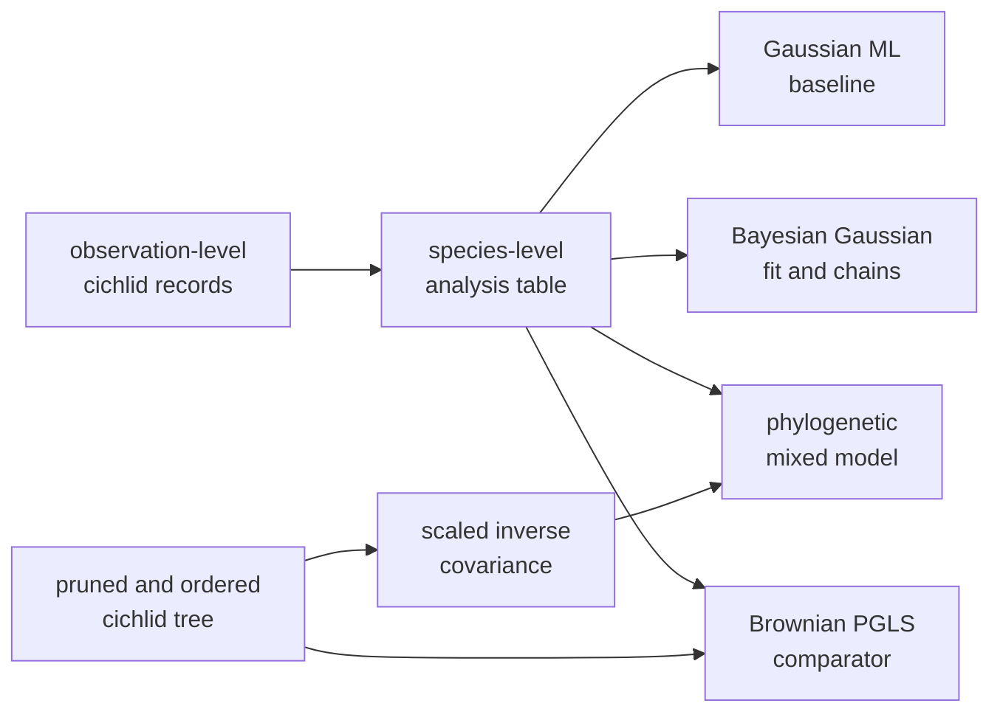

# Cichlid Bayesian Linear And Phylogenetic Mixed Models

This directory is the governed PCM4 design record for the transition from a
species-level Gaussian baseline to Bayesian regression and a phylogenetic
mixed model on cichlid parasite observations. It preserves the lecture source,
data and tree identity, seven claim boundaries, and the records required for a
future posterior comparison.

It does not contain governed posterior evidence. All seven manifests are
`not_comparable`, and every results manifest records
`governed_primary_output_count: 0`.

## Current Evidence State

| Record | Intended comparison | Verdict |
| --- | --- | --- |
| `evidence-001` | data–tree alignment and species aggregation | `not_comparable` |
| `evidence-002` | non-phylogenetic Gaussian maximum-likelihood baseline | `not_comparable` |
| `evidence-003` | Bayesian Gaussian summaries and chain diagnostics | `not_comparable` |
| `evidence-004` | scaled inverse covariance and random-effect setup | `not_comparable` |
| `evidence-005` | phylogenetic mixed-model fixed effects | `not_comparable` |
| `evidence-006` | phylogenetic and residual variance components | `not_comparable` |
| `evidence-007` | Brownian PGLS comparator | `not_comparable` |

The authored `reference.R` and `analysis.py` files are executable contract
wrappers. They produce local contract/run records; they do not execute
`MCMCglmm`, produce a Bijux mixed-model posterior, or retain governed primary
scientific outputs.

## Model Dependency Chain

The four estimator families answer related but non-identical questions. A GLS
standard error is not a posterior interval, PGLS covariance is not a random
effect, and matching a fixed-effect point estimate does not establish matching
variance components or chain behavior.

## Record Authority

| Path | What it establishes |
| --- | --- |
| `datasets/` | study-local observations, tree, and lecture workspace |
| `provenance/lund-course-sources.json` | source origin and study boundary |
| `reference/lund_pcm4_mixed_model_source.R` | formulas, objects, priors, chains, inverse covariance, and comparator intended by PCM4 |
| bundle manifests and claims | bounded comparison identities and current verdicts |
| bundle checks and results manifests | required files and explicit zero-primary-output state |
| public PCM4 guide | model interpretation and closure requirements |

Reviewer summaries project this state. They do not supply coefficients,
posterior draws, intervals, variance partitions, effective sample sizes, or
convergence evidence.

## Earliest Missing Evidence

The first missing dependency is governed execution on both sides of each
claim. A comparable lane must retain:

- the observation-to-species aggregation and exact included taxa;
- fixed and random formulas, family, link, and parameter names;
- tree identity, tip/random-effect order, inverse construction, and scaling;
- priors, initialization, seeds, chain count, iterations, burn-in, thinning,
  monitored quantities, and failures;
- raw or losslessly reviewable posterior draws plus normalized summaries;
- effective sample size, autocorrelation, and between-chain diagnostics;
- parameter-level observation keys and distributional/tolerance rules;
- the Brownian PGLS result as its own maximum-likelihood comparator.

The denominator includes initialized and failed chains, absent parameters,
non-finite draws, and excluded observations. A favorable summary over only
successful parameters is incomplete evidence.

## Capability Boundary

Bijux has native Bayesian and comparative components near this problem, but no
governed PCM4-equivalent hierarchical mixed-model posterior is retained here.
Native DNA or trait posteriors, generic sampler diagnostics, and PGLS results
cannot inherit the `MCMCglmm` estimand. They become evidence only through a
claim-specific execution and comparison contract.

## Reviewer Route

1. Establish the cichlid population and tree identity from datasets and
   provenance.
2. Read the lecture source to recover the exact estimator, random-effect,
   inverse-covariance, prior, and chain contracts.
3. Inspect each bundle's manifest, authored wrappers, checks, and zero-primary-
   output results manifest.
4. Preserve `not_comparable` for all seven claims until paired scientific
   outputs and adjudicated observations exist.
5. Continue with the public
   [PCM4 guide](../../../docs/03-bijux-phylogenetics-evidence-book/pcm4-cichlid-bayesian-linear-and-phylogenetic-mixed-models/index.md)
   for the full posterior closure contract.
