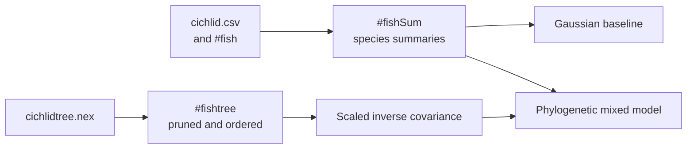

# PCM4 Dataset Catalog

This directory keeps the checked-in study inputs for the PCM4 cichlid mixed
model dossier.

The catalog distinguishes raw observations, a species-level analytical table,
and the tree aligned to that table. Moving between those units changes the
likelihood and denominator.

## Source Copies

- `cichlid.csv`: copied observation-level lecture table
- `cichlidtree.nex`: copied lecture phylogeny
- `fishdata.RData`: copied lecture workspace containing `fish`, `fishSum`, and
  `fishtree`

## Study Contract

- `registry.json`: machine-readable dataset inventory for the PCM4 study

PCM4 does not yet claim repository-owned posterior parity, but the source
inputs for that study are now preserved locally inside this dossier.

## Analytical Population

The registry contains five identities:

| Dataset | Unit and role |
| --- | --- |
| `cichlid.csv` | observation-level traits, parasite counts, habitat metrics and species identifiers |
| `cichlidtree.nex` | source phylogeny used to define phylogenetic covariance |
| `fishdata.RData#fish` | course-side repaired observation-level table |
| `fishdata.RData#fishSum` | species-level summary consumed by Gaussian and mixed-model fits |
| `fishdata.RData#fishtree` | workspace tree ordered for the species-level analysis |

A comparable rerun must retain aggregation keys and functions, observation and
species counts, excluded records, the final species order, tree pruning, and
matrix ordering. Loading `fishSum` successfully does not reconstruct how it
was derived from `fish`.
