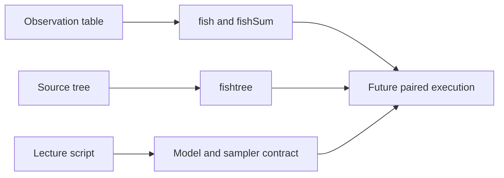

# PCM4 Provenance Guide

This directory records the source intake contract for the PCM4 study.

## Files

- `lund-course-sources.json`: governed descriptor for the copied lecture
  script and copied cichlid source datasets that define the study boundary

## Source Boundary

Four read-only source records define PCM4:

| Source identity | Repository record |
| --- | --- |
| `lund-pcm4-script` | lecture formulas, priors, covariance construction and chain setup |
| `lund-pcm4-cichlid-table` | observation-level source table |
| `lund-pcm4-cichlid-tree` | source Nexus phylogeny |
| `lund-pcm4-fishdata-rdata` | workspace providing `fish`, `fishSum` and `fishtree` |

The workspace is a source artifact, not proof that its objects can be
reconstructed from the adjacent CSV and Nexus files under undocumented course
state. A governed rerun must either reproduce and record that derivation or
identify the workspace objects directly, including their exact bytes and
object names.

Future MCMCglmm extraction and Bijux mixed-model execution will require new
provenance records; neither is implied by the current four-source intake.
