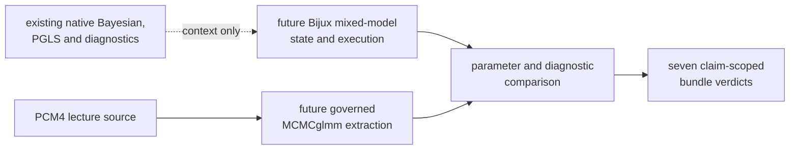

# PCM4 Runtime Reference Mapping

`lund_pcm4_mixed_model_source.R` is the checked source definition for PCM4.
It names the observation aggregation, Gaussian baseline, Bayesian chains,
scaled tree inverse, phylogenetic mixed model, and Brownian PGLS comparator
that a governed reproduction must preserve.

There is currently no executable reference extraction or repository-owned
mixed-model implementation registered in this directory. The seven bundles
contain contract wrappers and zero governed primary outputs.

## Source Objects And Required Evidence

| Source object | Meaning | Evidence needed for comparison |
| --- | --- | --- |
| `fish` and `fishtree` | repeated observations and pruned tree | input hashes, taxon exclusions, row/tip identity |
| `fishSum` | species-level aggregation | grouping keys, aggregation rules, resulting population |
| `glsFish` | Gaussian ML baseline | formula, coefficients, uncertainty, likelihood, diagnostics |
| `m1`, `m1a`, `m1b`, `m1c` | Gaussian posterior chains | priors, chain state, draws, summaries, convergence diagnostics |
| `inv.fishphylo` | scaled inverse tree covariance | tree/tip order, scaling, matrix identity, random-effect levels |
| `m2` | phylogenetic mixed-model posterior | fixed effects, variance components, draws, diagnostics |
| `pgls6` | Brownian ML comparator | covariance, coefficients, likelihood, diagnostics |

## Ownership Boundary

`MCMCglmm` owns the preserved lecture computation. Bijux owns its current
native Bayesian, comparative, and diagnostic implementations. The evidence
bundle owns correspondence. None of those ownership statements creates the
missing Bijux PCM4 mixed-model estimand.

## Why Adjacent Methods Are Insufficient

A Brownian PGLS fit can qualify the lecture's comparator claim but cannot
produce a random-effect posterior. Generic posterior diagnostics can assess
draws but cannot create the model that generated them. Native Bayesian DNA,
clock, or continuous-trait models have different state and likelihood
contracts. Reusing their sampler components does not make their posteriors
comparable with `m2`.

## Admission Requirements

A future reference path must emit immutable, provenance-bound outputs for all
monitored parameters and chains. A future Bijux path must expose the same
estimands under an explicit state, prior, covariance, and execution contract.
Only after both sides retain paired outputs may the bundle define
normalization, posterior comparison rules, exclusions, and verdicts.

Until that boundary is crossed, contract wrapper execution is useful integrity
evidence but not scientific posterior evidence.
