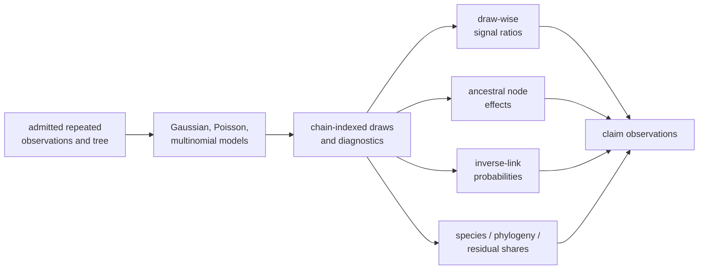

# Cichlid Phylogenetic Generalized Linear Mixed Models

This directory is the governed PCM5 design record for posterior phylogenetic
signal, ancestral effects, Poisson counts, infection outcomes,
probability-scale summaries, repeated observations, and variance partitioning
in the cichlid study.

It preserves nine claim boundaries and their scientific dependencies. It does
not contain governed generalized mixed-model posterior evidence: every bundle
is `not_comparable`, and every results manifest records zero governed primary
outputs.

## Current Evidence State

| Record | Intended comparison | Verdict |
| --- | --- | --- |
| `evidence-001` | workspace reload and repeated-observation data contract | `not_comparable` |
| `evidence-002` | Gaussian posterior phylogenetic signal | `not_comparable` |
| `evidence-003` | ancestral-node posterior extraction | `not_comparable` |
| `evidence-004` | tree-linked ancestral presentation | `not_comparable` |
| `evidence-005` | Poisson phylogenetic count posterior | `not_comparable` |
| `evidence-006` | infection model and latent/logit summaries | `not_comparable` |
| `evidence-007` | draw-wise probability transformation | `not_comparable` |
| `evidence-008` | repeated-measure species and phylogenetic random effects | `not_comparable` |
| `evidence-009` | species, phylogenetic, and residual variance shares | `not_comparable` |

The bundle-local scripts are executable contract wrappers. They identify
inputs and intended outputs but do not execute the source `MCMCglmm` models,
produce corresponding Bijux posteriors, or retain posterior draws and
diagnostics.

## Posterior Dependency Graph

Every derived quantity depends on governed parent draws. A node table,
probability curve, or variance partition cannot become primary evidence when
the chain, parameter, scale, and model identities that produced it are absent.

## Nested Denominators

PCM5 requires explicit accounting at several levels:

- declared, admitted, excluded, missing, and repeated source observations;
- represented species, matched/pruned tree tips, and random-effect order;
- initialized, completed, failed, excluded, and retained chains;
- generated, burn-in, thinned, non-finite, transformed, and retained draws;
- expected, present, absent, aliased, and comparable parameters, nodes,
  categories, and variance components;
- selected, comparable, matched, mismatched, and non-comparable claim rows.

Large draw counts cannot compensate for a missing chain, species, variance
component, node identity, or eligible comparison row.

## Model-Family Boundaries

| Family | Identity required before comparison |
| --- | --- |
| Poisson count | link, offset/exposure, dispersion treatment, priors, count scale, random effects |
| infection outcome | `multinomial2` state/category coding, latent residual convention, link, priors, random effects |
| repeated observations | observation unit, species effect, phylogenetic effect, residual structure, covariance scaling |
| ancestral effects | exact tree, node descendant set, parameter scale, chain/draw identity, summary rule |
| probability summaries | paired coefficient draws, predictor values, inverse link, draw-wise transformation |
| variance shares | complete same-draw numerator and denominator components, including family-specific residual term |

`summarize_phylogenetic_logistic` and other nearby comparative tools do not
instantiate these `MCMCglmm` model contracts. They are relevant adjacent
capability, not substitute posterior evidence.

## Record Authority

The source scripts `reference/PCM5_PGLMM.R` and
`reference/PCM5_extra_code.R` define the preserved model sequence. `datasets/`
and provenance own source identity. Bundle manifests own claim status and
freshness. Checks and results manifests expose the zero-primary-output state.
The public guide explains interpretation and closure but does not own a
scientific value.

## Reviewer Route

1. Establish observation, species, tree, and source-script identity.
2. Select the model family and read its claim manifest, source object, priors,
   random effects, link/scale, and required outputs.
3. Trace every derived quantity to its required same-draw parent components.
4. Confirm that primary posterior outputs and claim observations remain absent.
5. Preserve `not_comparable` until paired executions, complete denominators,
   diagnostics, transformations, and comparison rules are retained.
6. Continue with the public
   [PCM5 guide](../../../docs/03-bijux-phylogenetics-evidence-book/pcm5-cichlid-phylogenetic-generalized-linear-mixed-models/index.md)
   for model-specific closure requirements.
