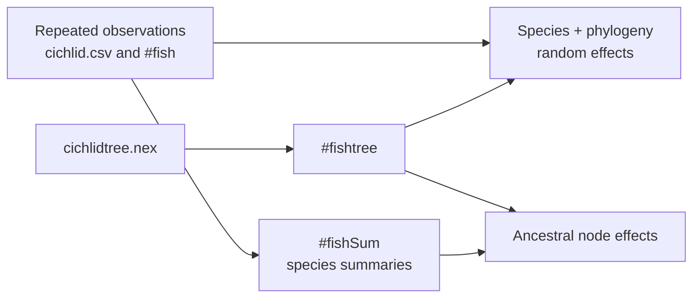

# PCM5 Dataset Catalog

This directory keeps the checked-in study inputs for the PCM5 generalized
cichlid mixed model dossier.

PCM5 uses both repeated observations and species-level summaries. Those are
different statistical populations even when they come from the same workspace.

## Source Copies

- `cichlid.csv`: copied observation-level lecture table
- `cichlidtree.nex`: copied lecture phylogeny
- `fishdata.RData`: copied lecture workspace containing `fish`, `fishSum`, and
  `fishtree`

## Study Contract

- `registry.json`: machine-readable dataset inventory for the PCM5 study

PCM5 remains explicit about its posterior boundary, but the study inputs no
longer depend on files outside this dossier.

## Population And Tree Roles

| Dataset | Role |
| --- | --- |
| `cichlid.csv` and `fishdata.RData#fish` | repeated observation population for count, infection and repeated-effect models |
| `fishdata.RData#fishSum` | species-level population for summarized and ancestral/model variants |
| `cichlidtree.nex` and `fishdata.RData#fishtree` | source and workspace tree identities for phylogenetic effects |

For each claim retain the observation unit, repeated-measure key, admitted and
excluded rows, species population, response/category coding, offsets or
exposures, tree pruning, tip order, and random-effect level mapping. A species
count cannot stand in for the repeated-observation denominator.
