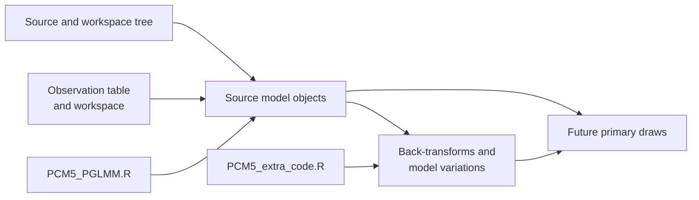

# PCM5 Provenance Guide

This directory records the source intake contract for the PCM5 study.

## Files

- `lund-course-sources.json`: governed descriptor for the copied lecture
  scripts and copied cichlid source datasets that define the PCM5 study

## Registered Source Graph

Five read-only source records define the current boundary:

| Source identity | Role |
| --- | --- |
| `lund-pcm5-script` | main Gaussian, Poisson, multinomial and repeated-effect sequence |
| `lund-pcm5-extra-script` | back-transform and additional mixed-model derivations |
| `lund-pcm5-cichlid-table` | repeated-observation source table |
| `lund-pcm5-cichlid-tree` | source phylogeny |
| `lund-pcm5-fishdata-rdata` | workspace providing `fish`, `fishSum` and `fishtree` |

The supplementary script depends on objects and conventions established by the
main sequence. Preserve both source hashes and their dependency whenever a
governed observation uses a supplementary derivation.

No current source record identifies an executed MCMCglmm extraction or a Bijux
generalized mixed-model posterior. Those records must be added explicitly when
the comparison boundary is crossed.
