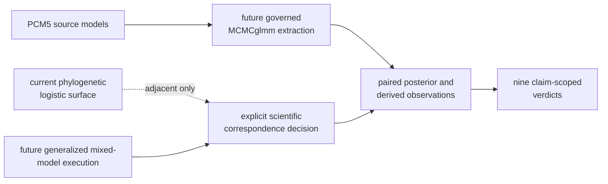

# PCM5 Runtime Reference Mapping

`PCM5_PGLMM.R` and `PCM5_extra_code.R` are the checked source definitions for
the PCM5 model and derivation sequence. They cover Gaussian, Poisson, and
`multinomial2` phylogenetic models, ancestral effects, probability transforms,
repeated observations, and posterior variance shares.

No governed reference extraction or repository-owned generalized mixed-model
posterior execution is registered here. The nine bundles contain contract
wrappers and zero governed primary outputs.

## Source-To-Evidence Map

| Source object or derivation | Required governed evidence |
| --- | --- |
| `m2` and `m2PhyloSig` | Gaussian model draws, variance components, same-draw signal ratios, diagnostics |
| `m3` and `blupsm3` | exact tree/node keys, node-effect draws, posterior summaries and intervals |
| `m5` | Poisson family/link, priors, count population, random effects, draws, diagnostics |
| `m6` and `m6PhyloSig` | infection category coding, latent residual convention, variance draws and signal ratios |
| `m7` | paired intercept/slope draws and draw-wise inverse-link values over declared predictors |
| `m10` | repeated-observation identity plus `species` and `treetip` random-effect draws |
| `m10PhyloSig` and `m10spSig` | same-draw species, phylogenetic and residual components with complete denominator |

## Adjacent Runtime Surface

Bijux provides `summarize_phylogenetic_logistic` in
`comparative/regression/logistic.py`. It offers an owned reviewer-facing
phylogenetic logistic fit, but it is not an `MCMCglmm` `multinomial2`
posterior, does not carry PCM5's random-effect hierarchy, and does not produce
the lecture's draw-wise signal or variance partitions.

Shared input columns or a binary response do not establish correspondence. A
future mapping must say which estimand, scale, random effects, and uncertainty
objects can be compared and which remain structurally different.

## Derived-Quantity Admission

Admit a probability, ancestral summary, signal ratio, or variance share only
when its source rows retain model, chain, draw, parameter/component, scale, and
tree/node identity. Apply nonlinear transforms and variance ratios within the
same draw before summarizing; transforming marginal summaries constructs a
different quantity.

## Observation Keys By Model Family

| Family | Required key beyond the parameter name |
| --- | --- |
| Gaussian signal | chain, draw, phylogenetic/residual component pair and ratio definition |
| ancestral effects | exact tree, descendant-tip node key, chain, draw and effect scale |
| Poisson counts | response, offset/exposure, link, parameter, random-effect level and draw |
| infection outcomes | category coding, latent/logit scale, residual convention, parameter and draw |
| probability curves | paired coefficient draw, predictor value and inverse-link definition |
| repeated effects | observation/species unit, species and treetip component identities |
| variance shares | same-draw complete component set and family-specific residual term |

Sorting by a display label is not enough. Every paired observation must resolve
the same estimand, component and draw identity on both sides before a
distributional or tolerance rule is evaluated.

## Execution Identity

A governed comparison must bind source-script and dataset hashes, R and
`MCMCglmm` versions, Bijux revision, model family/link, formulas, priors,
random-effect and tree order, chain policy, seeds, failures, raw draws,
diagnostics, derived-row keys, normalization, exclusions, and adjudication
rules. Until those records exist, wrapper execution is integrity evidence, not
posterior correspondence.

Retain source-script identity per observation. Main-model rows and
supplementary back-transform rows may consume the same fitted object while
having different derivation contracts.
