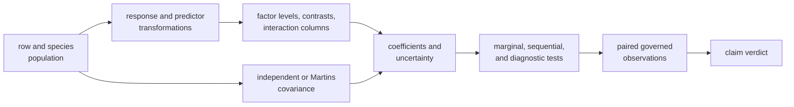

# Primate Continuous And Categorical Regression

This directory is the governed PCM3 design record for multivariable primate
regression with continuous predictors, categorical contrasts, interactions,
transformations, and phylogenetic covariance. It defines eight bounded claims
and the evidence needed to compare the lecture workflow with Bijux.

It is not a numerical parity record. Every bundle manifest is
`not_comparable`, and every bundle currently retains zero governed primary
output paths.

## Current Evidence State

| Record | Required comparison surface | Verdict |
| --- | --- | --- |
| `evidence-001` | source intake, workspace reload, and population alignment | `not_comparable` |
| `evidence-002` | baseline continuous-plus-categorical GLS | `not_comparable` |
| `evidence-003` | transformed response, diagnostics, and model tests | `not_comparable` |
| `evidence-004` | intercept-free group parameterization | `not_comparable` |
| `evidence-005` | continuous-by-categorical interaction | `not_comparable` |
| `evidence-006` | predictor scaling and intercept semantics | `not_comparable` |
| `evidence-007` | Martins-covariance phylogenetic regression | `not_comparable` |
| `evidence-008` | post-correction diagnostics and hypothesis tests | `not_comparable` |

`not_comparable` records missing aligned observations, not a failed fit and not
a numerical disagreement. There are no governed lecture/Bijux coefficient,
likelihood, p-value, contrast, or diagnostic pairs to adjudicate.

## Why Design Identity Comes First

Matching formula text does not prove matching design matrices. Factor order,
reference level, centering, scaling, row exclusions, species order, covariance
construction, likelihood convention, and test family all change the meaning
of the reported values.

## What Is Retained

| Path | Authority |
| --- | --- |
| `datasets/` | study-local source copies and governed primate derivatives |
| `provenance/lund-course-sources.json` | source, derivative, and relevant runtime lineage |
| `reference/lund_pcm3_contcat_source.R` | checked lecture source defining the intended analyses |
| `evidence-*/manifest.json` | claim identity, limitations, freshness basis, and current verdict |
| bundle claim and check records | required model semantics and closure conditions |

The public runtime contains relevant PGLS contrast, interaction, covariance,
model-selection, and residual-review surfaces. Those implementations are
inputs to future comparison work; their existence is not a primary study
output.

## Evidence Required For Closure

For each claim, retain both independently produced primary outputs plus a
comparison contract:

- exact included rows and species order;
- response transform and predictor centering/scaling constants;
- factor levels, reference level, contrast matrix, and design-column names;
- tree identity, branch scale, covariance definition, and fitted parameters;
- coefficient estimates, uncertainty, likelihood, and convergence state;
- hypothesis identity, test ordering, degrees of freedom, and diagnostic scale;
- observation keys, normalization rules, tolerances, and exclusions.

Only then can a bundle distinguish `matched`, `matched_with_tolerance`,
`mismatch_explained`, or `mismatch_unexplained`. Adding output paths without
their provenance and identities would create files, not evidence.

## Reviewer Route

1. Read the source and dataset provenance to establish the intended lecture
   population and models.
2. Select one bundle and inspect its manifest, claim, checks, limitations, and
   zero-primary-output state.
3. Use `reference/README.md` to locate nearby runtime surfaces without
   treating them as executed PCM3 observations.
4. Preserve all eight bundles in coverage summaries; do not report only the
   easiest model family.
5. Continue with the public
   [PCM3 guide](../../../docs/03-bijux-phylogenetics-evidence-book/pcm3-primate-continuous-and-categorical-regression/index.md)
   for design-matrix interpretation and the claim closure matrix.
