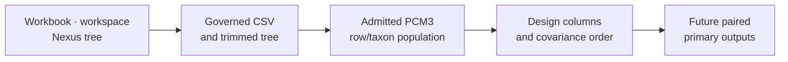

# PCM3 Dataset Catalog

This directory keeps the checked-in study inputs for the PCM3 multivariable
primate regression dossier.

The catalog distinguishes container files, named workspace objects, and
governed derivatives so regression design cannot depend on an implicit object
loaded from an R session.

## Source Copies

- `primate_raw.xlsx`: copied lecture workbook
- `primate.RData`: copied lecture workspace containing `primate` and
  `primatetree`
- `primatetree.nex`: copied lecture tree for the regression family

## Governed Derivatives

- `reference_primate.csv`: study-local governed primate table used to make the
  regression assumptions reviewable
- `reference_trimmed_primatetree.nwk`: study-local governed trimmed tree used
  to keep tree alignment explicit inside PCM3

## Study Contract

- `registry.json`: machine-readable dataset inventory for the PCM3 study

## Identity Required For Regression

The six registry entries identify the workbook, standalone Nexus tree,
`primate.RData#primate`, `primate.RData#primatetree`, governed CSV, and governed
trimmed tree. Before either implementation runs, retain:

- exact included rows and species order;
- response and predictor columns with types and units;
- missing-value and duplicate-species decisions;
- factor levels and reference ordering;
- transformation, centering, and scaling constants;
- tree rooting, branch scale, and table-to-tip reconciliation.

The governed derivatives make the intended input bytes inspectable. They do
not by themselves establish the design matrix used by either future execution;
that identity belongs in the claim-scoped output record.
