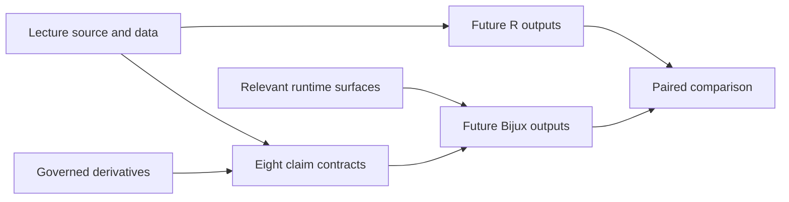

# PCM3 Provenance Guide

This directory records the source intake contract for the PCM3 study.

## Files

- `lund-course-sources.json`: governed descriptor for the copied lecture
  script, copied lecture datasets, study-local governed derivatives, and the
  nearby repository runtime surfaces that matter to PCM3

## Registered Lineage

The descriptor separates six records:

| Source identity | Role in the study |
| --- | --- |
| `lund-pcm3-script` | read-only definition of the eight lecture analysis families |
| `lund-pcm3-primate-rdata` | read-only workspace providing table and tree objects |
| `lund-pcm3-primate-workbook` | read-only multivariable source workbook |
| `lund-pcm3-primate-tree` | read-only source tree |
| `governed-pcm3-reference-artifacts` | study-local derivative table and tree |
| `pcm3-runtime-surfaces` | mutable implementation surface relevant to future Bijux execution |

Runtime provenance establishes where implementation behavior comes from; it
does not fill the missing output slots. Changes to the lecture source,
derivatives, runtime surface, extraction logic, or observation contract each
invalidate a different edge and must remain distinguishable in freshness
review.
