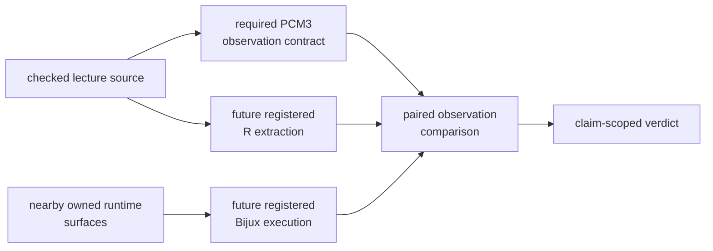

# PCM3 Runtime Reference Mapping

PCM3 has a checked lecture source and relevant repository implementations, but
it does not yet have governed paired primary outputs. This map distinguishes
source definition, implementation capability, execution evidence, and verdict
so that adjacent code is not mistaken for completed parity.

## Source Boundary

`lund_pcm3_contcat_source.R` defines the lecture analyses: baseline GLS,
response transformation, categorical parameterizations, interactions,
predictor scaling, Martins covariance, and post-correction diagnostics. The
study-local inputs under `../datasets/` preserve the associated primate
workspace, tree, and governed derivatives.

No extracted R result file is registered here, and the bundle manifests retain
no governed primary output paths from either implementation.

## Nearby Owned Runtime Surfaces

| Public operation | Owned module | Relevance |
| --- | --- | --- |
| `summarize_pgls_categorical_contrasts` | `comparative/pgls/categorical_contrasts.py` | factor levels, reference coding, and contrast summaries |
| `summarize_pgls_interaction_coefficients` | `comparative/pgls/interaction_coefficients.py` | interaction terms and reconstructed conditional slopes |
| `summarize_brownian_covariance_pgls` | `comparative/pgls/brownian_covariance.py` | Brownian covariance regression review |
| `summarize_ou_covariance_pgls` | `comparative/pgls/ou_covariance.py` | OU covariance regression review |
| `compare_comparative_regression_models` | `comparative/regression/model_selection.py` | shared-population model comparison and exclusion accounting |
| `summarize_phylogenetic_residuals` | `comparative/regression/residuals.py` | reviewer-facing residual summaries |

These surfaces demonstrate that the runtime has relevant vocabulary and
operations. They do not demonstrate the lecture's exact population, design
matrix, covariance, coefficient names, hypotheses, or outputs.

## Earliest Open Boundary

The earliest missing dependency is paired primary execution evidence. It is
not broader API coverage. Before any coefficient can be compared, both paths
must retain the same row population, transformations, factor coding, design
columns, tree scale, covariance convention, and hypothesis definitions.

Until those records exist, `not_comparable` is the correct bundle verdict.
Running one nearby helper, copying a coefficient into a report, or linking a
unit test would not satisfy the evidence contract.

## Primary Output Contract

| Bundle family | Required paired rows |
| --- | --- |
| source and baseline GLS | admitted population, design columns, coefficients, covariance, likelihood and execution state |
| transformed and categorical models | transform constants, factor/contrast matrix, coefficients, hypotheses and diagnostics |
| interaction and scaling models | reconstructed slopes, interaction columns, centering/scaling identity and uncertainty |
| Martins covariance model | tree order, covariance parameters, fitted coefficients, likelihood and convergence |
| post-correction review | residual rows, test identity/order, degrees of freedom and diagnostic scale |

The R and Bijux paths must emit independently keyed primary records before a
normalization or tolerance is applied. A manually transcribed lecture value is
not an execution output, and a generated report is not a primary result.

## Required Rerun Record

A future comparison must bind the lecture source and study-local input hashes,
R and package versions, Bijux revision, exact formulas and transformations,
factor/contrast state, tree and covariance identity, outputs and diagnostics,
observation normalization, tolerance, exclusions, and terminal execution
state. Every one of the eight bundle manifests must then be adjudicated at its
own claim scope.

The first successful rerun should preserve all eight requested terminal states,
including refused or failed executions. Selecting only the model families that
produce convenient coefficients would change the coverage denominator.
