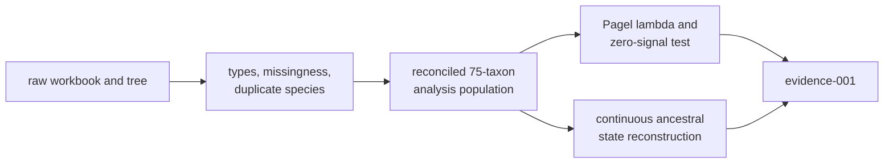

# Primate Longevity Signal

This study is the governed PCM1 record for primate data preparation, tree
reconciliation, phylogenetic signal, and continuous ancestral reconstruction.
It establishes the prepared primate population reused by later studies and
keeps every population-changing operation visible before model output is
interpreted.

## Current Evidence State

| Record | Scientific surface | Verdict |
| --- | --- | --- |
| `evidence-001` | aggregate lecture reconstruction | `matched_with_tolerance` |
| `evidence-002` | workbook loading | `matched` |
| `evidence-003` | type repair | `matched` |
| `evidence-004` | missing-data accounting | `matched` |
| `evidence-005` | duplicate-species aggregation | `matched` |
| `evidence-006` | source and trimmed tree import | `matched` |
| `evidence-007` | rootedness, topology, and node-label diagnostics | `matched` |
| `evidence-008` | tree–trait correspondence | `matched` |
| `evidence-009` | governed processed exports | `matched` |

These values come from each bundle's `manifest.json`. The aggregate verdict is
not a claim that every lecture block is numerically comparable: its manifest
separately counts verified, tolerance-matched, plot-only, artifact-only,
seeded-input-only, and workflow-only blocks.

## Claim Map

| Claim family | Required parent evidence | Primary comparison record | Evidence that cannot replace it |
| --- | --- | --- | --- |
| processed trait population | workbook identity, repaired types, missingness, duplicate aggregation | focused bundles `evidence-002` through `evidence-005` | final row count alone |
| prepared tree population | source/trimmed tree identity, rooting, branch lengths, excluded tips | `evidence-006` and `evidence-007` | successful Newick parsing |
| tree–trait correspondence | exact retained sets, normalization, order, and representative identities | `evidence-008` | equal counts or matching filenames |
| reusable study derivatives | accepted table/tree content and checksums | `evidence-009` | a similarly named derivative from PCM2 or PCM3 |
| signal and ancestral correspondence | every preparation parent plus aligned R/Bijux outputs and scalar rules | aggregate `evidence-001` | plots, reviewer summary, or nearby runtime capability |

This map explains why PCM1 uses focused bundles instead of treating its
aggregate result as one indivisible proof. A preparation failure reopens every
dependent analytical claim; a plotting limitation does not retroactively
invalidate a governed numerical observation.

## Read The Evidence In Dependency Order

| Decision | Owning record | Why it precedes the next decision |
| --- | --- | --- |
| Which source files entered the study? | `provenance/lund-course-sources.json` and `datasets/registry.json` | source and derivative identities must be fixed before transformations are compared |
| Which rows and types survived intake? | `evidence-002` through `evidence-005` | type repair, missingness and duplicate aggregation define the trait population |
| Which tree survived preparation? | `evidence-006` and `evidence-007` | import, trimming, rooting and node-label interpretation define the structural object |
| Which taxa joined one-to-one? | `evidence-008` | signal and ancestral calculations depend on the reconciled 75-taxon population |
| Which governed derivatives were emitted? | `evidence-009` | downstream execution must identify the exact table and tree bytes it consumed |
| Which analytical observations correspond? | `evidence-001` | only the aggregate bundle compares the registered signal and ancestral outputs |

Do not begin with the lambda estimate or ancestral table and infer that the
preparation chain matched. The focused bundles are independent prerequisites,
not supplementary detail.

## Scientific Dependency Chain

A change to type coercion, row exclusion, duplicate aggregation, tree pruning,
or species mapping creates a different analytical population. Matching final
taxon counts do not establish that two populations are identical.

## Record Layout

| Path | Authority |
| --- | --- |
| `datasets/` | source copies and governed primate derivatives used by the bundles |
| `provenance/lund-course-sources.json` | origin and role of lecture sources, datasets, and repository adapters |
| `reference/` | lecture source plus executable R and Bijux reference paths |
| `evidence-001/` | aggregate claim, comparison records, block payloads, and review summaries |
| `evidence-002/` through `evidence-009/` | focused preparation and export contracts |

Within a bundle, begin with `manifest.json`, then read
`inputs.manifest.json`, `claims.json`, `checks.json`, and the machine-readable
files under `results/`. `report.md` supplies context after those records have
established identity and status.

## What The Aggregate Comparison Retains

The aggregate bundle records the prepared 75-taxon population, longevity
summary, estimated Pagel lambda, the lambda-zero likelihood-ratio comparison,
continuous ancestral estimates, branch-change summaries, and the R/Bijux
comparison rule for each scalar. The checked result inventory also retains
block-level classifications so rendering and workflow coverage cannot be
mistaken for numerical equivalence.

The aggregate result has two denominators: registered lecture blocks and
numerically comparable observations within those blocks. Plot-only and
workflow-only coverage remains visible in the first denominator but does not
enter the second. Any percentage or summary must identify which denominator it
uses.

Use the descendant-taxon signature to identify an internal node. A lecture
node label is not durable enough on its own because parsing, pruning, or
rerooting can change internal numbering while preserving the clade.

## Claim Boundary

PCM1 supports the registered preparation, tree correspondence, processed
export, signal, and ancestral comparisons for this study family. It does not
establish:

- plot-for-plot equivalence with the R graphics stack;
- accuracy across unrelated trees, traits, or taxonomic populations;
- interchangeability of APE, GEIGER, phytools, and Bijux beyond the recorded
  observations;
- causal interpretation of phylogenetic signal or reconstructed change.

The aggregate bundle explicitly lists rendered-figure equivalence as out of
scope. Preserve that limitation whenever the result is summarized.

## Reviewer Route

1. Confirm source and derivative identities in `datasets/` and `provenance/`.
2. Establish the transformation chain with `evidence-002` through
   `evidence-009`.
3. Inspect the R and Bijux result JSON and the scalar parity table in
   `evidence-001/results/`.
4. Read the aggregate manifest verdict, block status counts, limitations, and
   freshness basis.
5. Use the reviewer summary and public
   [PCM1 guide](../../../docs/03-bijux-phylogenetics-evidence-book/pcm1-primate-longevity-signal/index.md)
   as interpretation aids, not substitutes for the governed records.
