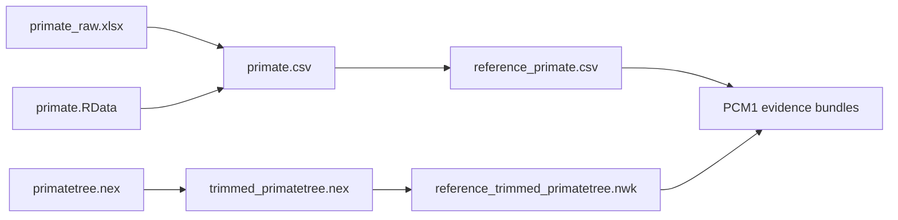

# PCM1 Dataset Catalog

This directory keeps the checked-in study inputs for the PCM1 primate
longevity and signal dossier.

The files form a lineage from immutable lecture copies to repository-governed
derivatives. Similar names do not make them interchangeable.

## Source Copies

- `primate_raw.xlsx`: lecture workbook copied into the repository so the intake
  surface is reviewable without opening the backlog archive
- `primate.RData`: lecture workspace snapshot retained as a source artifact
- `primate.csv`: lecture-side processed table exported before the governed
  derivative checks
- `primatetree.nex`: original lecture tree
- `trimmed_primatetree.nex`: lecture-side trimmed tree after pruning

## Governed Derivatives

- `reference_primate.csv`: repository-owned normalized primate table used by
  the governed PCM1 evidence bundles
- `reference_trimmed_primatetree.nwk`: repository-owned trimmed tree used by
  the governed PCM1 evidence bundles

The arrows describe the study lineage, not permission to regenerate one file
from whichever neighbor is convenient. The focused preparation bundles record
the accepted transformations and observations.

## Study Contract

- `registry.json`: machine-readable inventory for the study contract and
  publish-readiness checks

The registry assigns stable dataset IDs, distinguishes
`repository-owned-source-copy` from `study-local-governed-derivative`, and
records each locator and schema summary. Bundle `inputs.manifest.json` files
then bind the exact local inputs and governed outputs used by one claim unit.

Before rerunning a bundle, verify the registry entry, file checksum in the
input manifest, taxon population, column/state meaning, tree format, and
source-versus-derivative role. A byte change to a source copy is a provenance
event; a byte change to a governed derivative is a new analytical input.
