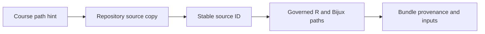

# PCM1 Provenance Guide

This directory records the source intake contract for the PCM1 study.

The descriptor establishes which repository files are source copies, which
path in the originating course material they represent, and which
repository-owned adapters are allowed to turn those sources into observations.

## Files

- `lund-course-sources.json`: governed descriptor for the checked-in lecture
  script, copied source datasets, and repository-owned reference adapters

## Inspect A Source Record

Each entry carries a stable `source_id`, human label, source kind, repository
locator, read-only status, and—where available—the original course path and
concept tags. Review all seven registered entries before accepting a rerun:
the lecture script, raw workbook, workspace, original and trimmed trees,
processed table, and governed adapter directory.

The path hint explains origin; the repository locator identifies the checked
copy used by this study. Neither substitutes for the bundle input checksum.
If a source copy or reference adapter changes, preserve the new bytes, refresh
the dependent input manifests, rerun affected observations, and review
freshness before citing the prior verdict.
