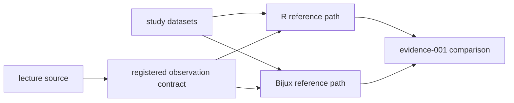

# PCM1 Runtime Reference Mapping

This directory connects the PCM1 lecture source to two executable reference
paths and to the owned runtime operations being compared. It is an execution
map, not a second verdict ledger; bundle manifests under `../evidence-*` own
the current claim status.

## Reference Paths

| File | Role |
| --- | --- |
| `lund_pcm1_plots_signal_source.R` | checked lecture source that defines the study boundary |
| `primate_lifespan_signal_reference_r.R` | R extraction path for registered reference observations |
| `primate_lifespan_signal_reference_bijux.py` | Bijux extraction path for the corresponding structured observations |

The execution paths consume the study-local files under `../datasets/`. Their
outputs are retained in `../evidence-001/results/` as native R observations,
Bijux observations, comparison tables, and block-level payloads.

## Bijux Ownership Map

The Bijux reference path calls public tree inspection and validation, numeric
trait readiness and summary, Pagel-lambda estimation, and continuous ancestral
reconstruction. It also uses owned comparative covariance, pruning, topology,
tree-loading, and node-signature helpers to reproduce the registered lecture
observations.

The important ownership distinction is:

- the runtime owns its parsing, transformations, models, estimates, and
  diagnostics;
- the R path owns its independently executed reference observations;
- the evidence bundle owns normalization, tolerance, comparison, and verdict;
- this README owns none of those values.

## Identity Requirements

A rerun must preserve the lecture source identity, study-local input bytes,
reference script bytes, Bijux revision, dependency versions, random seed where
used, observation keys, and tolerance policy. Internal nodes are compared by
descendant-taxon signature rather than transient numeric labels.

If the parser, preparation rules, reference scripts, registered observation
set, or tolerances change, regenerate the governed results and freshness
record. Similar headline values from an unregistered run cannot replace the
bundle observations.

## Supported And Excluded Correspondence

The current manifests support direct or tolerance-bounded correspondence for
the registered preparation, tree, signal, and ancestral observations. They do
not claim plot-for-plot identity for lecture graphics. Plot-only payloads are
retained to show coverage and lineage while remaining outside the numerical
parity denominator.
