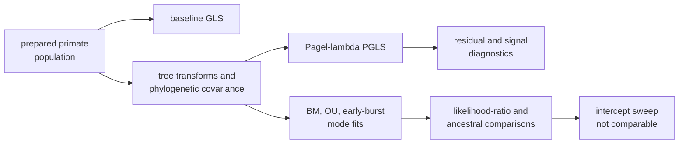

# Primate PGLS And Signal

This directory is the governed PCM2 record for baseline regression,
Pagel-lambda PGLS, phylogenetic signal, tree transformations, evolutionary-mode
fits, likelihood-ratio comparisons, residual review, and ancestral estimates
on the prepared primate population.

PCM2 deliberately carries two status layers. Ten focused bundle manifests
adjudicate bounded claims; the aggregate scalar table retains a wider set of
cross-implementation observations. A reader must inspect both before making a
study-wide statement.

## Current Bundle Ledger

| Record | Scientific surface | Verdict |
| --- | --- | --- |
| `evidence-001` | workspace reload semantics | `matched` |
| `evidence-002` | baseline GLS | `matched` |
| `evidence-003` | estimated-lambda regression | `matched_with_tolerance` |
| `evidence-004` | phylogenetic signal and lambda-zero test | `matched_with_tolerance` |
| `evidence-005` | residual diagnostics | `matched_with_tolerance` |
| `evidence-006` | OU, early-burst, and late-burst tree transforms | `matched` |
| `evidence-007` | Brownian, OU, and early-burst fits | `matched_with_tolerance` |
| `evidence-008` | evolutionary-mode likelihood-ratio tests | `matched_with_tolerance` |
| `evidence-009` | named-node ancestral estimates | `matched_with_tolerance` |
| `evidence-010` | `corBlomberg` intercept sweep | `not_comparable` |

The scalar parity table retained with `evidence-001` also contains 12
`mismatch_unexplained` observations across transformed-tree totals,
early-burst fitting, one likelihood-ratio comparison, ancestral vectors, and
one residual diagnostic. Those rows remain scientific debt; favorable focused
bundle verdicts do not remove them.

## Decision Structure

The baseline and phylogenetic models share response and taxon identity but do
not share residual covariance. A coefficient is therefore meaningful only
with its model, population, transform, and diagnostic record.

## Record Authority

| Record | What it owns |
| --- | --- |
| bundle `manifest.json` | claim identity, comparison mode, freshness basis, limitations, and verdict |
| `inputs.manifest.json` | material input identity and dependency linkage |
| `checks.json` and machine results | observation rules, tolerances, values, and outcomes |
| `evidence-001/results/scalar-parity-table.json` | broad PCM2 scalar comparison, including unexplained mismatches |
| `reference/` | lecture source and registered R reference observations |
| public PCM2 guide | reader route and interpretation boundary |

The generated reviewer summary is a projection of these records. It cannot
turn `not_comparable` into a match or drop mismatch rows from the denominator.

## What Can Be Said

The registered baseline GLS, estimated-lambda regression, signal, and several
focused model comparisons agree directly or within declared tolerances. In
particular, the retained slope change between baseline GLS and Pagel-lambda
PGLS demonstrates the consequence of changing residual covariance on this
population.

A PCM2-wide parity claim is not supported. The intercept sweep lacks a
registered comparable observation, and the scalar ledger retains unexplained
disagreements. These are different failure classes: absence of a comparison
contract is not a numerical mismatch.

## Reviewer Route

1. Confirm the governed primate derivatives and source provenance.
2. Choose the focused claim whose model and output match the intended
   statement; read its manifest, inputs, checks, and results.
3. For evolutionary-mode or study-wide language, include the aggregate scalar
   table and its complete mismatch denominator.
4. Inspect `evidence-010` before discussing lecture coverage.
5. Verify freshness after any change to runtime definitions, reference
   observations, derivatives, or tolerance rules.

Continue with the public
[PCM2 study guide](../../../docs/03-bijux-phylogenetics-evidence-book/pcm2-primate-pgls-and-signal/index.md)
for the result tables and citation boundaries.
