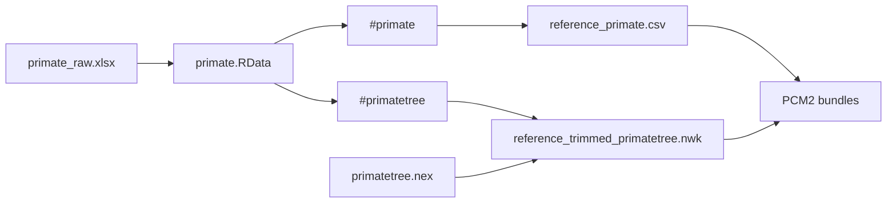

# PCM2 Dataset Catalog

This directory keeps the checked-in study inputs for the PCM2 primate PGLS and
signal dossier.

PCM2 is deliberately self-contained. Its governed CSV and trimmed tree have
study-local identities even when their biological content descends from the
PCM1 preparation family.

## Source Copies

- `primate_raw.xlsx`: copied lecture workbook for the PCM2 family
- `primate.RData`: copied lecture workspace containing `primate` and
  `primatetree`
- `primatetree.nex`: copied lecture tree kept next to the workspace inputs

## Governed Derivatives

- `reference_primate.csv`: study-local governed primate table used by the PCM2
  reload, regression, and signal bundles
- `reference_trimmed_primatetree.nwk`: study-local governed trimmed tree used
  by the PCM2 reload, regression, and signal bundles

## Study Contract

- `registry.json`: machine-readable dataset inventory for the PCM2 study

## Workspace And File Identity

The registry distinguishes six identities: a raw workbook, the `primate` and
`primatetree` objects inside the checked workspace, a standalone Nexus tree,
and two governed derivatives. The fragment locators
`primate.RData#primate` and `primate.RData#primatetree` matter: one container
file does not make its table and tree the same dataset.

Before a rerun, resolve the registry locator, source/derivative kind, exact
bytes, object name where applicable, admitted taxon order, variable types, tree
rooting and branch semantics. A similarly named PCM1 file is not an implicit
fallback.
