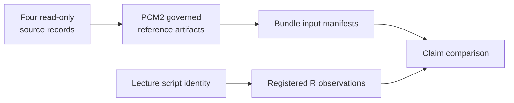

# PCM2 Provenance Guide

This directory records the source intake contract for the PCM2 study.

## Files

- `lund-course-sources.json`: governed descriptor for the copied lecture
  script, copied lecture workspace inputs, and the study-local governed
  derivatives used by the evidence bundles

PCM2 is intentionally self-contained: the provenance contract should be
auditable from this study directory alone.

## Source Population

The descriptor contains five stable source records:

| Source | Role |
| --- | --- |
| `lund-pcm2-script` | read-only lecture workflow defining the covered methods |
| `lund-primate-rdata` | read-only workspace providing the `primate` table and `primatetree` object |
| `lund-pcm2-primate-workbook` | read-only workbook source copy |
| `lund-pcm2-primate-tree` | read-only Nexus tree source copy |
| `governed-pcm2-reference-artifacts` | mutable study-local CSV and trimmed-tree derivatives |

Self-contained means the study resolves its own registered files; it does not
mean the derivatives lack lineage. When a read-only source or the lecture
script changes, treat it as new source intake. When a governed derivative
changes, refresh affected inputs and results while preserving the source IDs
that explain its origin.
