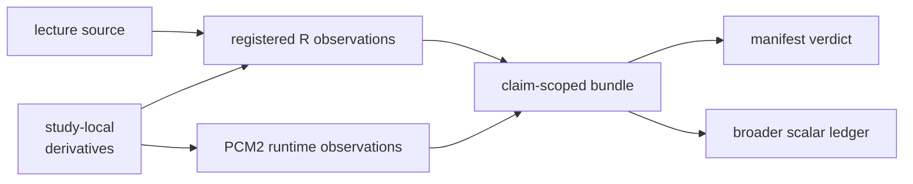

# PCM2 Runtime Reference Mapping

This directory anchors the PCM2 comparison to the lecture source and the
registered R observations. Repository-owned PCM2 definitions and runtime
adapters live under
`bijux_phylogenetics/evidence/studies/primate_pgls_and_signal`; bundle manifests
connect those code paths to individual claims.

## Reference Inventory

| File | Role |
| --- | --- |
| `lund_pcm2_modes_pgls_source.R` | checked lecture source defining the covered workflow |
| `primate_pgls_and_signal_reference_r.R` | executable R extraction path |
| `reference_results.json` | registered R observations consumed by focused comparisons |

The source and reference path operate on study-local copies under
`../datasets/`. The evidence bundles retain their own input manifests so a
comparison cannot silently resolve a similarly named file from another study.

## Runtime Ownership

The owned PCM2 evidence implementation is separated into durable concerns:

| Module | Responsibility |
| --- | --- |
| `definitions.py` | claim and observation definitions |
| `registry.py` | study and bundle registration |
| `runtime.py` | repository-owned observation production |
| `parity.py` | comparison construction and normalization |
| `bundles.py` | evidence-bundle assembly |

These modules do not make the R result authoritative and the R script does not
decide the Bijux result. The bundle comparison owns correspondence rules,
tolerances, and the resulting claim verdict.

## Comparison Boundaries

Direct and tolerance-bounded claims cover registered baseline, PGLS, signal,
diagnostic, transform, mode-fit, likelihood-ratio, and named-node ancestral
surfaces. They do not establish uniform agreement for every scalar retained by
the study. The aggregate scalar ledger's 12 unexplained mismatches must remain
visible beside the focused verdicts.

`evidence-010` is different again: the `corBlomberg` intercept sweep is
`not_comparable` because the required registered observations are absent. Do
not reinterpret that absence as a failed numerical comparison or as an implied
match.

## Admit A Comparison

| Surface | Identity required before values are compared |
| --- | --- |
| baseline GLS and PGLS | response, design columns, admitted rows, residual covariance and likelihood convention |
| Pagel lambda and signal | tree/trait population, parameter bounds, null rule and optimization state |
| tree transformations | source tree, transformation definition, parameter and branch-length summary rule |
| BM, OU and early/late-burst fits | candidate model, parameterization, tree scale, starts, bounds and likelihood convention |
| likelihood-ratio tests | named nested pair, comparable observation population and degrees-of-freedom rule |
| ancestral observations | model, trait scale, structurally keyed node and uncertainty definition |

If identity does not align, do not construct a delta or tolerance outcome. The
record is `not_comparable` when a required observation contract is absent; it
is a mismatch only after comparable observations exist and violate their rule.

## Rerun Identity

Preserve the lecture source, study-local datasets, reference script and result
bytes, Bijux revision, dependency versions, model parameterization, node
identity convention, observation registry, and tolerance policy. A change to
any of them requires fresh outputs and re-adjudication at every dependent
bundle and aggregate ledger.

The checked `reference_results.json` is a registered observation source, not a
timeless expected answer. Its script, dependency, dataset, parameterization and
observation-registry identities travel with every consumed value.
