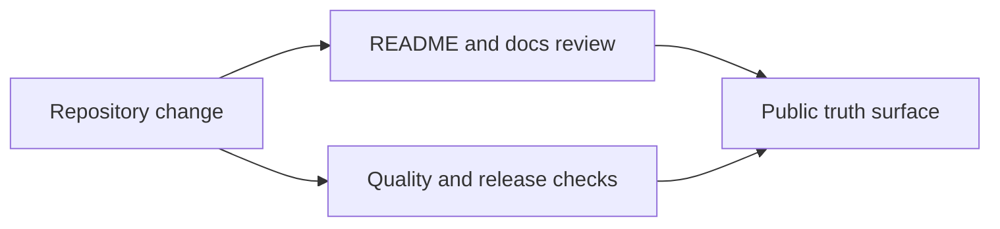

# bijux-phylogenetics-dev

<!-- bijux-phylogenetics-badges:generated:start -->

<!-- bijux-phylogenetics-badges:generated:end -->

Repository-owned developer tooling and automation helpers for
`bijux-phylogenetics`.

This package owns repository checks for docs synchronization, badge rendering,
license asset management, quality gates, and release support. It is intended
for maintainers working from the repository workspace, not as the runtime entry
point for end users.

Its packaging surface now also owns the installed-artifact smoke proof that
builds the runtime wheel and sdist, installs each into a clean virtual
environment, copies packaged example inputs through the installed runtime API,
and verifies packaged example and dataset resources through the public CLI.

It also owns the maintainer-side guardrails that keep the published story
aligned across READMEs, public docs, maintainer docs, quality reports, and
package metadata.

Choose this package when you are maintaining documentation, release readiness,
or repository policy surfaces rather than consuming the public runtime.

## What This Package Governs

- documentation ownership across the root README, package READMEs, and public
  handbooks
- native surface documentation so public pages do not hide locally owned
  likelihood, inference, and benchmark work
- public trust surface maintenance across evidence-book guides, release
  summaries, and quality narratives
- release surface alignment so package metadata, docs, and governed reports do
  not drift apart

## Why This Package Exists Publicly

The repository is large enough that documentation and release truth are part
of the product surface. This package exists so that:

- public docs do not undersell the runtime
- package metadata does not contradict the docs
- evidence language does not drift into overclaiming
- release readiness depends on narrative integrity as well as green checks

## Why This Matters

The runtime package can only be trusted if its packaging, documentation, and
release claims remain synchronized. This package exists to keep that review
work explicit and repository-owned rather than leaving it to ad hoc manual
cleanup.

## Read this next

- [Maintainer handbook](https://bijux.io/bijux-phylogenetics/03-bijux-phylogenetics-maintain/)
- [Documentation system](https://bijux.io/bijux-phylogenetics/03-bijux-phylogenetics-maintain/documentation-system/)
- [Documentation ownership](https://bijux.io/bijux-phylogenetics/03-bijux-phylogenetics-maintain/documentation-system/documentation-ownership/)
- [Native surface documentation](https://bijux.io/bijux-phylogenetics/03-bijux-phylogenetics-maintain/documentation-system/native-surface-documentation/)
- [Trust surfaces](https://bijux.io/bijux-phylogenetics/03-bijux-phylogenetics-maintain/trust-surfaces/)
- [Public trust surface maintenance](https://bijux.io/bijux-phylogenetics/03-bijux-phylogenetics-maintain/trust-surfaces/public-trust-surface-maintenance/)
- [Public interface and artifact maintenance](https://bijux.io/bijux-phylogenetics/03-bijux-phylogenetics-maintain/trust-surfaces/public-interface-and-artifact-maintenance/)
- [Trust lane and study guide maintenance](https://bijux.io/bijux-phylogenetics/03-bijux-phylogenetics-maintain/trust-surfaces/trust-lane-and-study-guide-maintenance/)
- [Repository operations](https://bijux.io/bijux-phylogenetics/03-bijux-phylogenetics-maintain/repository-operations/)
- [Release surface alignment](https://bijux.io/bijux-phylogenetics/03-bijux-phylogenetics-maintain/repository-operations/release-surface-alignment/)
- [Maintainer source on GitHub](https://github.com/bijux/bijux-phylogenetics/tree/main/packages/bijux-phylogenetics-dev)
- [Developer tooling changelog](https://github.com/bijux/bijux-phylogenetics/blob/main/packages/bijux-phylogenetics-dev/CHANGELOG.md)
- [Security policy](https://github.com/bijux/bijux-phylogenetics/blob/main/SECURITY.md)
