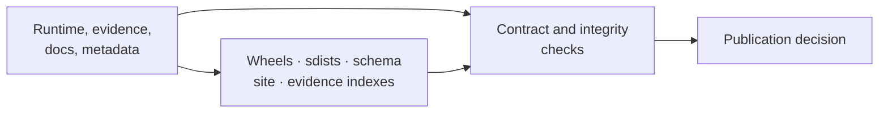
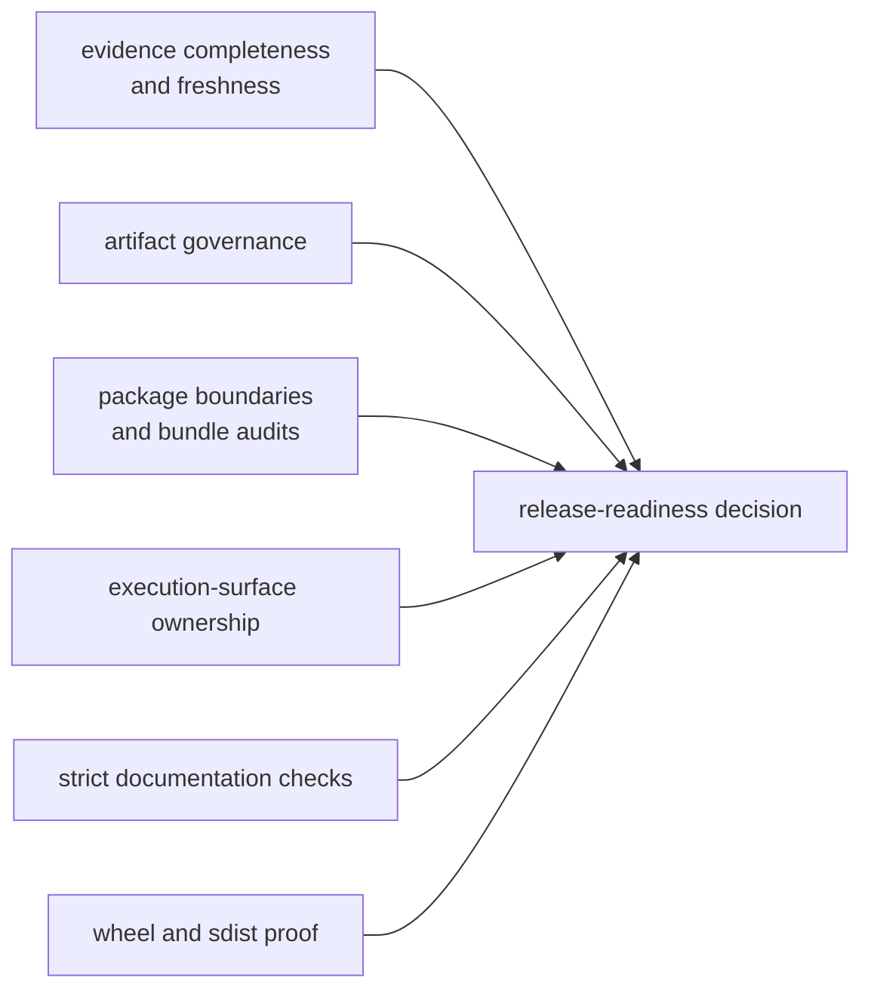
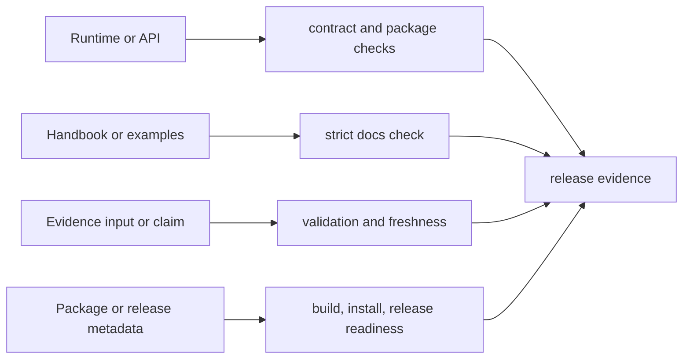
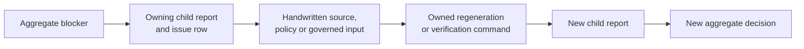

# bijux-phylogenetics-dev

<!-- bijux-phylogenetics-badges:generated:start -->
[](https://github.com/bijux/bijux-phylogenetics)
[](https://github.com/bijux/bijux-phylogenetics/blob/main/LICENSE)
[](https://github.com/bijux/bijux-phylogenetics/actions/workflows/verify.yml?query=branch%3Amain)
[](https://github.com/bijux/bijux-phylogenetics/actions/workflows/release-pypi.yml)
[](https://github.com/bijux/bijux-phylogenetics/actions/workflows/release-ghcr.yml)
[](https://github.com/bijux/bijux-phylogenetics/actions/workflows/release-github.yml)
[](https://github.com/bijux/bijux-phylogenetics/actions/workflows/deploy-docs.yml)
<!-- bijux-phylogenetics-badges:generated:end -->

Repository verification and publication tooling for `bijux-phylogenetics`.
This package is used by maintainers and CI; it is not part of the scientific
runtime and is not required to run an analysis.

## Who Should Install It

Install this package only in a repository-maintenance environment that must
answer one or more of these questions:

| Maintainer need | Evidence produced or checked |
| --- | --- |
| review a change | scoped contract, boundary, documentation, and evidence checks |
| inspect a distributable | wheel and source-archive contents plus clean-environment smoke results |
| publish the documentation site | site construction, managed-asset, badge, link, and truth-contract results |
| assess an evidence release | bundle identity, completeness, closure, freshness, and index records |
| authorize publication | an aggregate decision linked to every required child report |

Do not add it to an analysis environment merely to run models, parse trees, or
render reports. The development package intentionally carries repository
automation and its dependencies; the runtime package owns the scientific
objects and methods. Keeping those environments separate makes package smoke
tests representative and prevents a maintainer dependency from becoming an
undeclared requirement of a published analysis.

## Install It For Repository Decisions

Use `bijux-phylogenetics-dev` when the question concerns repository integrity,
evidence governance, built distributions, documentation publication, or
release eligibility. Use `bijux-phylogenetics` when the question concerns a
scientific analysis.

| Question | Correct owner | Incorrect substitute |
| --- | --- | --- |
| can this tree or model be analyzed? | runtime validation and method contract | a passing repository release gate |
| does a governed bundle support this claim? | Evidence Book claim and observation records | package installation success |
| does the wheel contain required runtime resources? | package bundle and installed-artifact checks | an editable source import |
| can this repository revision be published? | aggregate release-readiness decision | one favorable child report |

The maintainer package consumes scientific and repository records; it does not
manufacture a favorable scientific verdict. Its strongest behavior is refusal
when required evidence, package content, or policy alignment is absent.



## A Release Decision Joins Three Ledgers

Repository readiness is reconstructable only when source, execution, and
artifact identities agree.

| Ledger | Required identity | Contradiction that blocks reuse |
| --- | --- | --- |
| source | repository revision, configuration, governed inputs, dependency state | a source or policy change after the check ran |
| execution | command, environment, tool versions, start/terminal state, exit status | a copied report with no matching execution or an interrupted run presented as complete |
| artifacts | child reports, package hashes, site/evidence inventories, checksums | missing, mixed-revision, hand-edited, or regenerated outputs |

The aggregate publication decision is a join over these ledgers, not a fourth
source of truth. If any key changes, rerun the owning check and every consumer
of its report. This preserves favorable evidence that is still applicable
without carrying it across a revision where its inputs no longer match.

## What This Package Never Decides

| Question | Why it remains elsewhere | Correct authority |
| --- | --- | --- |
| Is a model appropriate for a biological question? | repository policy cannot replace study design | analyst, domain review, and model assumptions |
| Did a native or external method compute the intended estimand? | a release gate consumes rather than creates scientific state | typed runtime or engine result and diagnostics |
| Do two implementations correspond numerically? | package integrity is not a comparison observation | registered parity case or Evidence Book claim |
| Is a `not_comparable` study actually “close enough”? | absence of aligned evidence cannot be repaired by publication policy | bundle manifest, missing-output record, and closure contract |
| May a failed child report be omitted from readiness? | the aggregate denominator is governed | release policy and complete child-report inventory |

The package may verify that these authorities are present, current, and
internally coherent. It must refuse publication when required records are
missing or contradictory; it must not synthesize the scientific decision that
the missing record would have owned.

## Owned Verification Domains

| Domain | Responsibilities |
| --- | --- |
| API | freeze the versioned OpenAPI contract and detect drift |
| documentation | synchronize managed assets and badges; validate site construction |
| artifacts | enforce output location and repository hygiene contracts |
| evidence | validate inputs, bundle completeness, indexes, and publication readiness |
| packages | build and inspect wheels/sdists; install into clean environments; smoke-test packaged resources |
| quality | dependency, boundary, docstring, runtime-budget, and execution-surface checks |
| release | resolve versions, stage license assets, and guard publication conditions |
| workspace | maintain deliberate compatibility aliases into `artifacts/` |

## Package Verification

The installed-artifact smoke path builds the runtime wheel and source
distribution, installs each into a clean environment, copies packaged example
inputs through the public API, and exercises packaged examples and dataset
resources through public commands. This catches failures hidden by editable
repository imports.

## Evidence Governance

Evidence checks distinguish structural completeness, input identity,
provenance, execution, verdict, freshness, and publication eligibility.
Scientific verdicts use `matched`, `matched_with_tolerance`,
`mismatch_explained`, `mismatch_unexplained`, and `not_comparable`. Open or
blocked follow-through belongs to the resolution workflow, not the verdict
vocabulary. Tooling must preserve both records and must not convert either one
to passing status to satisfy a release check.

## Repository Commands

The supported interface is repository automation rather than a public analysis
CLI:

```bash
make install
make check
make docs-check
make package-verify
```

These commands create transient environments and reports under `artifacts/`.
Individual Python modules are implementation surfaces for repository
automation and may have narrower compatibility than the runtime API.

## Governed Report Map

| Decision | Owning command | Retained record |
| --- | --- | --- |
| Are evidence bundles structurally complete? | `make check-evidence-completeness` | `artifacts/root/evidence-completeness.json` |
| Are local output paths and caches governed? | `make check-artifact-governance` | `artifacts/root/artifact-governance.json` |
| Do imports and dependencies respect package roles? | `make check-package-boundaries` | `artifacts/root/package-boundaries.json` |
| Do commands execute through declared owners? | `make check-execution-surfaces` | `artifacts/root/execution-surfaces.json` |
| Are packages and evidence eligible for publication? | `make check-release-readiness` | `artifacts/root/publish-readiness.json` |

Treat the command exit status as the gate and the JSON record as the
reconstruction evidence. A copied success message without its revision,
configuration, and retained report is not a release decision record.

## Gate Failure Ownership

| Failed record | First owner to inspect | Do not substitute |
| --- | --- | --- |
| evidence completeness | missing bundle field, input manifest, or declared artifact | a favorable study-guide sentence |
| artifact governance | command destination, cache policy, alias target, or output inventory | an ignore rule that hides the path |
| package boundaries | distribution dependency, import ownership, or archive content | a source-checkout import that bypasses the wheel |
| execution surfaces | Make, tox, workflow, or command ownership policy | an unrelated command that happens to pass |
| documentation truth | canonical runtime, schema, evidence record, or public projection | deletion of the assertion without resolving the contradiction |
| release readiness | the named blocking report and its issue rows | a manually edited aggregate status |

The aggregate release report should make failure attribution narrower, not
flatter. Preserve the blocking report, correct its earliest owning source,
regenerate any governed projection, and rerun the consumers of that report.
An unavailable optional engine remains unavailable in its own denominator; it
must not be erased to make the aggregate presentation green.

## Read Report Dependencies



The aggregate gate consumes owned reports; it does not replace them. When
release readiness fails, inspect the named blocking report and its issue rows
before changing code or generated output.

## Preserve Aggregate Decision Inputs

An aggregate `ready` status is valid only for the exact child reports,
repository revision, policy files, and package artifacts it evaluated. Retain
those identities in the handoff instead of copying the aggregate JSON alone.

| Aggregate input | Contradiction that invalidates reuse |
| --- | --- |
| evidence completeness and freshness | a bundle, input manifest, checksum, or verdict changed |
| documentation truth and site build | a public projection or generated reference changed |
| package boundaries and bundles | dependency policy, archive inventory, metadata, or built artifact changed |
| execution and artifact governance | command ownership, output path, cache, or alias policy changed |
| publication policy | required packages, closure criteria, or blocking codes changed |

If any child identity changes, regenerate the owning report and then the
aggregate decision. Do not reuse favorable child status from another revision
or replace a failed child with a newer report while retaining older siblings;
that creates a release packet that no single repository state produced.

## What The Governed Commands Establish

| Command | Evidence produced | It does not establish alone |
| --- | --- | --- |
| `make check` | repository contract, style, type, unit, and configured quality results | optional external-engine or full study execution |
| `make docs-check` | synchronized assets, strict site construction, links, and documentation hygiene | scientific correctness of every documented model |
| `make package-verify` | built wheel/sdist inspection plus clean-environment installation and resource smoke tests | publication or registry availability |
| `make validate-evidence-book` | bundle structure, indexes, freshness, and issue inventory | passing verdicts for open or non-comparable claims |
| `make check-release-readiness` | aggregate release-policy decision and retained governance reports | authority to weaken a failed or blocked gate |

Read command output and its retained artifacts together. A zero exit status
without the governed inputs or expected report set is not reconstructable
release evidence.

## Change-To-Check Map



Run the narrow owning check while editing, then the aggregate gate that
consumes its result. Do not repair a failing governed artifact by hand when a
repository command owns its generation.

## Handle A Failed Gate Without Bypassing It

1. Preserve the command exit state and generated JSON report.
2. Identify the exact issue row, owner, input, and expected invariant.
3. Determine whether the owner is handwritten source, generated projection,
   environment prerequisite, or an external engine.
4. Change the owning source or satisfy the declared prerequisite.
5. Regenerate governed projections through their repository command.
6. Rerun the narrow gate, then every aggregate gate that consumes its report.

Do not delete the report, weaken the rule, reclassify a mismatch, or hand-edit
a generated success status. If an external prerequisite is unavailable, retain
the blocked or skipped state at the lane that owns it and keep unrelated proof
usable.

## Trace One Failure To Closure



Closure requires a new child report and a new aggregate decision from the same
repository state. A corrected source beside an old failure report is still an
unverified repair. A favorable aggregate assembled from child reports produced
at different revisions is not a valid publication record.

## Verification Handoff Record

A maintainable handoff names the repository revision, exact commands, exit
states, report paths, issue counts, package versions, evidence verdict counts,
and any lane that was not executed. “All checks passed” without the owning
reports is not sufficient for release reconstruction.

## Publication Invariants

- canonical and alias packages resolve to compatible runtime behavior;
- built artifacts contain licenses, package data, examples, and metadata;
- pinned schemas and hashes agree;
- generated README badges and documentation assets are current;
- evidence indexes agree with bundle records and freshness policy;
- local verification does not pollute the source tree;
- release credentials and publication occur only through governed workflows.

## Documentation

- [Maintainer handbook](https://bijux.io/bijux-phylogenetics/05-bijux-phylogenetics-maintain/)
- [Documentation ownership](https://bijux.io/bijux-phylogenetics/05-bijux-phylogenetics-maintain/documentation-system/documentation-ownership/)
- [Cross-surface contract maintenance](https://bijux.io/bijux-phylogenetics/05-bijux-phylogenetics-maintain/trust-surfaces/public-trust-surface-maintenance/)
- [Artifact hygiene](https://bijux.io/bijux-phylogenetics/05-bijux-phylogenetics-maintain/repository-operations/artifact-hygiene/)
- [Release surface alignment](https://bijux.io/bijux-phylogenetics/05-bijux-phylogenetics-maintain/repository-operations/release-surface-alignment/)
- [Reading an evidence bundle](https://bijux.io/bijux-phylogenetics/03-bijux-phylogenetics-evidence-book/reading-an-evidence-bundle/)
- [Claim verdicts and resolution](https://bijux.io/bijux-phylogenetics/03-bijux-phylogenetics-evidence-book/claim-verdicts-and-resolution/)
- [Source](https://github.com/bijux/bijux-phylogenetics/tree/main/packages/bijux-phylogenetics-dev)

Apache License 2.0.
