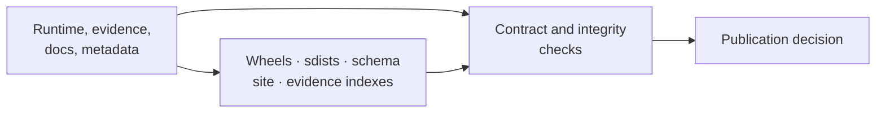
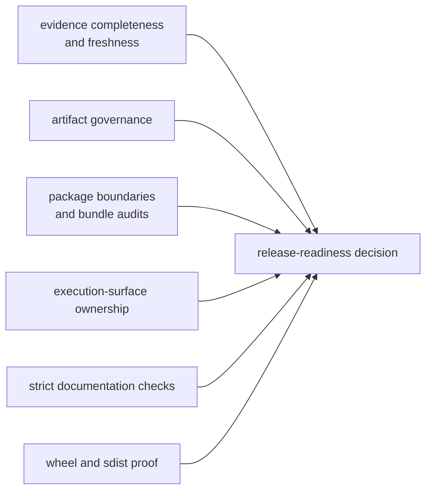
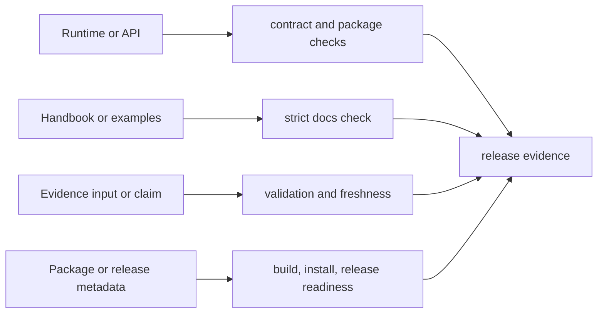

# bijux-phylogenetics-dev

<!-- bijux-phylogenetics-badges:generated:start -->
[](https://github.com/bijux/bijux-phylogenetics)
[](https://github.com/bijux/bijux-phylogenetics/blob/main/LICENSE)
[](https://github.com/bijux/bijux-phylogenetics/actions/workflows/verify.yml?query=branch%3Amain)
[](https://github.com/bijux/bijux-phylogenetics/actions/workflows/release-pypi.yml)
[](https://github.com/bijux/bijux-phylogenetics/actions/workflows/release-ghcr.yml)
[](https://github.com/bijux/bijux-phylogenetics/actions/workflows/release-github.yml)
[](https://github.com/bijux/bijux-phylogenetics/actions/workflows/deploy-docs.yml)
<!-- bijux-phylogenetics-badges:generated:end -->

Repository verification and publication tooling for `bijux-phylogenetics`.
This package is used by maintainers and CI; it is not part of the scientific
runtime and is not required to run an analysis.



## Owned Verification Domains

| Domain | Responsibilities |
| --- | --- |
| API | freeze the versioned OpenAPI contract and detect drift |
| documentation | synchronize managed assets and badges; validate site construction |
| artifacts | enforce output location and repository hygiene contracts |
| evidence | validate inputs, bundle completeness, indexes, and publication readiness |
| packages | build and inspect wheels/sdists; install into clean environments; smoke-test packaged resources |
| quality | dependency, boundary, docstring, runtime-budget, and execution-surface checks |
| release | resolve versions, stage license assets, and guard publication conditions |
| workspace | maintain deliberate compatibility aliases into `artifacts/` |

## Package Verification

The installed-artifact smoke path builds the runtime wheel and source
distribution, installs each into a clean environment, copies packaged example
inputs through the public API, and exercises packaged examples and dataset
resources through public commands. This catches failures hidden by editable
repository imports.

## Evidence Governance

Evidence checks distinguish structural completeness, input identity,
provenance, execution, verdict, freshness, and publication eligibility.
Scientific verdicts use `matched`, `matched_with_tolerance`,
`mismatch_explained`, `mismatch_unexplained`, and `not_comparable`. Open or
blocked follow-through belongs to the resolution workflow, not the verdict
vocabulary. Tooling must preserve both records and must not convert either one
to passing status to satisfy a release check.

## Repository Commands

The supported interface is repository automation rather than a public analysis
CLI:

```bash
make install
make check
make docs-check
make package-verify
```

These commands create transient environments and reports under `artifacts/`.
Individual Python modules are implementation surfaces for repository
automation and may have narrower compatibility than the runtime API.

## Governed Report Map

| Decision | Owning command | Retained record |
| --- | --- | --- |
| Are evidence bundles structurally complete? | `make check-evidence-completeness` | `artifacts/root/evidence-completeness.json` |
| Are local output paths and caches governed? | `make check-artifact-governance` | `artifacts/root/artifact-governance.json` |
| Do imports and dependencies respect package roles? | `make check-package-boundaries` | `artifacts/root/package-boundaries.json` |
| Do commands execute through declared owners? | `make check-execution-surfaces` | `artifacts/root/execution-surfaces.json` |
| Are packages and evidence eligible for publication? | `make check-release-readiness` | `artifacts/root/publish-readiness.json` |

Treat the command exit status as the gate and the JSON record as the
reconstruction evidence. A copied success message without its revision,
configuration, and retained report is not a release decision record.

## Gate Failure Ownership

| Failed record | First owner to inspect | Do not substitute |
| --- | --- | --- |
| evidence completeness | missing bundle field, input manifest, or declared artifact | a favorable study-guide sentence |
| artifact governance | command destination, cache policy, alias target, or output inventory | an ignore rule that hides the path |
| package boundaries | distribution dependency, import ownership, or archive content | a source-checkout import that bypasses the wheel |
| execution surfaces | Make, tox, workflow, or command ownership policy | an unrelated command that happens to pass |
| documentation truth | canonical runtime, schema, evidence record, or public projection | deletion of the assertion without resolving the contradiction |
| release readiness | the named blocking report and its issue rows | a manually edited aggregate status |

The aggregate release report should make failure attribution narrower, not
flatter. Preserve the blocking report, correct its earliest owning source,
regenerate any governed projection, and rerun the consumers of that report.
An unavailable optional engine remains unavailable in its own denominator; it
must not be erased to make the aggregate presentation green.

## Read Report Dependencies



The aggregate gate consumes owned reports; it does not replace them. When
release readiness fails, inspect the named blocking report and its issue rows
before changing code or generated output.

## What The Governed Commands Establish

| Command | Evidence produced | It does not establish alone |
| --- | --- | --- |
| `make check` | repository contract, style, type, unit, and configured quality results | optional external-engine or full study execution |
| `make docs-check` | synchronized assets, strict site construction, links, and documentation hygiene | scientific correctness of every documented model |
| `make package-verify` | built wheel/sdist inspection plus clean-environment installation and resource smoke tests | publication or registry availability |
| `make validate-evidence-book` | bundle structure, indexes, freshness, and issue inventory | passing verdicts for open or non-comparable claims |
| `make check-release-readiness` | aggregate release-policy decision and retained governance reports | authority to weaken a failed or blocked gate |

Read command output and its retained artifacts together. A zero exit status
without the governed inputs or expected report set is not reconstructable
release evidence.

## Change-To-Check Map



Run the narrow owning check while editing, then the aggregate gate that
consumes its result. Do not repair a failing governed artifact by hand when a
repository command owns its generation.

## Handle A Failed Gate Without Bypassing It

1. Preserve the command exit state and generated JSON report.
2. Identify the exact issue row, owner, input, and expected invariant.
3. Determine whether the owner is handwritten source, generated projection,
   environment prerequisite, or an external engine.
4. Change the owning source or satisfy the declared prerequisite.
5. Regenerate governed projections through their repository command.
6. Rerun the narrow gate, then every aggregate gate that consumes its report.

Do not delete the report, weaken the rule, reclassify a mismatch, or hand-edit
a generated success status. If an external prerequisite is unavailable, retain
the blocked or skipped state at the lane that owns it and keep unrelated proof
usable.

## Verification Handoff Record

A maintainable handoff names the repository revision, exact commands, exit
states, report paths, issue counts, package versions, evidence verdict counts,
and any lane that was not executed. “All checks passed” without the owning
reports is not sufficient for release reconstruction.

## Publication Invariants

- canonical and alias packages resolve to compatible runtime behavior;
- built artifacts contain licenses, package data, examples, and metadata;
- pinned schemas and hashes agree;
- generated README badges and documentation assets are current;
- evidence indexes agree with bundle records and freshness policy;
- local verification does not pollute the source tree;
- release credentials and publication occur only through governed workflows.

## Documentation

- [Maintainer handbook](https://bijux.io/bijux-phylogenetics/05-bijux-phylogenetics-maintain/)
- [Documentation ownership](https://bijux.io/bijux-phylogenetics/05-bijux-phylogenetics-maintain/documentation-system/documentation-ownership/)
- [Cross-surface contract maintenance](https://bijux.io/bijux-phylogenetics/05-bijux-phylogenetics-maintain/trust-surfaces/public-trust-surface-maintenance/)
- [Artifact hygiene](https://bijux.io/bijux-phylogenetics/05-bijux-phylogenetics-maintain/repository-operations/artifact-hygiene/)
- [Release surface alignment](https://bijux.io/bijux-phylogenetics/05-bijux-phylogenetics-maintain/repository-operations/release-surface-alignment/)
- [Source](https://github.com/bijux/bijux-phylogenetics/tree/main/packages/bijux-phylogenetics-dev)

Apache License 2.0.
