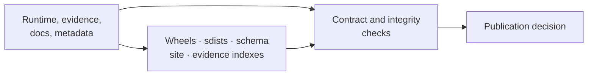

# bijux-phylogenetics-dev

<!-- bijux-phylogenetics-badges:generated:start -->
[](https://github.com/bijux/bijux-phylogenetics)
[](https://github.com/bijux/bijux-phylogenetics/blob/main/LICENSE)
[](https://github.com/bijux/bijux-phylogenetics/actions/workflows/verify.yml?query=branch%3Amain)
[](https://github.com/bijux/bijux-phylogenetics/actions/workflows/release-pypi.yml)
[](https://github.com/bijux/bijux-phylogenetics/actions/workflows/release-ghcr.yml)
[](https://github.com/bijux/bijux-phylogenetics/actions/workflows/release-github.yml)
[](https://github.com/bijux/bijux-phylogenetics/actions/workflows/deploy-docs.yml)
<!-- bijux-phylogenetics-badges:generated:end -->

Repository verification and publication tooling for `bijux-phylogenetics`.
This package is used by maintainers and CI; it is not part of the scientific
runtime and is not required to run an analysis.



## Owned Verification Domains

| Domain | Responsibilities |
| --- | --- |
| API | freeze the versioned OpenAPI contract and detect drift |
| documentation | synchronize managed assets and badges; validate site construction |
| artifacts | enforce output location and repository hygiene contracts |
| evidence | validate inputs, bundle completeness, indexes, and publication readiness |
| packages | build and inspect wheels/sdists; install into clean environments; smoke-test packaged resources |
| quality | dependency, boundary, docstring, runtime-budget, and execution-surface checks |
| release | resolve versions, stage license assets, and guard publication conditions |
| workspace | maintain deliberate compatibility aliases into `artifacts/` |

## Package Verification

The installed-artifact smoke path builds the runtime wheel and source
distribution, installs each into a clean environment, copies packaged example
inputs through the public API, and exercises packaged examples and dataset
resources through public commands. This catches failures hidden by editable
repository imports.

## Evidence Governance

Evidence checks distinguish structural completeness, input identity,
provenance, execution, verdict, freshness, and publication eligibility.
Open or blocked scientific verdicts remain valid governed states. Tooling must
not convert them to passing status to satisfy a release check.

## Repository Commands

The supported interface is repository automation rather than a public analysis
CLI:

```bash
make install
make check
make docs-check
make package-verify
```

These commands create transient environments and reports under `artifacts/`.
Individual Python modules are implementation surfaces for repository
automation and may have narrower compatibility than the runtime API.

## Publication Invariants

- canonical and alias packages resolve to compatible runtime behavior;
- built artifacts contain licenses, package data, examples, and metadata;
- pinned schemas and hashes agree;
- generated README badges and documentation assets are current;
- evidence indexes agree with bundle records and freshness policy;
- local verification does not pollute the source tree;
- release credentials and publication occur only through governed workflows.

## Documentation

- [Maintainer handbook](https://bijux.io/bijux-phylogenetics/05-bijux-phylogenetics-maintain/)
- [Documentation ownership](https://bijux.io/bijux-phylogenetics/05-bijux-phylogenetics-maintain/documentation-system/documentation-ownership/)
- [Cross-surface contract maintenance](https://bijux.io/bijux-phylogenetics/05-bijux-phylogenetics-maintain/trust-surfaces/public-trust-surface-maintenance/)
- [Artifact hygiene](https://bijux.io/bijux-phylogenetics/05-bijux-phylogenetics-maintain/repository-operations/artifact-hygiene/)
- [Release surface alignment](https://bijux.io/bijux-phylogenetics/05-bijux-phylogenetics-maintain/repository-operations/release-surface-alignment/)
- [Source](https://github.com/bijux/bijux-phylogenetics/tree/main/packages/bijux-phylogenetics-dev)

Apache License 2.0.
