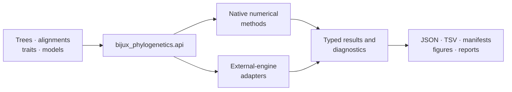

# bijux-phylogenetics

<!-- bijux-phylogenetics-badges:generated:start -->
[](https://pypi.org/project/bijux-phylogenetics/)
[](https://github.com/bijux/bijux-phylogenetics/blob/main/LICENSE)
[](https://github.com/bijux/bijux-phylogenetics/actions/workflows/verify.yml?query=branch%3Amain)
[](https://github.com/bijux/bijux-phylogenetics/actions/workflows/release-pypi.yml)
[](https://github.com/bijux/bijux-phylogenetics/actions/workflows/release-ghcr.yml)
[](https://github.com/bijux/bijux-phylogenetics/actions/workflows/release-github.yml)
[](https://github.com/bijux/bijux-phylogenetics/actions/workflows/deploy-docs.yml)

[](https://pypi.org/project/bijux-phylogenetics/)
[](https://pypi.org/project/phylogenetic/)

[](https://github.com/bijux/bijux-phylogenetics/pkgs/container/bijux-phylogenetics%2Fbijux-phylogenetics)
[](https://github.com/bijux/bijux-phylogenetics/pkgs/container/bijux-phylogenetics%2Fphylogenetic)

[](https://bijux.io/bijux-phylogenetics/01-bijux-phylogenetics/)
[](https://bijux.io/bijux-phylogenetics/01-bijux-phylogenetics/)
<!-- bijux-phylogenetics-badges:generated:end -->

The canonical Python distribution for the Bijux phylogenetics runtime. It
provides owned tree, likelihood, inference, comparative, ancestral, parsimony,
simulation, dataset, and reporting contracts together with explicit adapters
for selected external engines.

## Installation

```bash
python -m pip install bijux-phylogenetics
bijux-phylogenetics --help
```

Python 3.11 or newer is required. External-engine workflows also require their
named executable—such as MAFFT, trimAl, IQ-TREE2, FastTree, MrBayes, or
BEAST—to be installed separately.

## Runtime Map



## Capability Families

| Family | Examples |
| --- | --- |
| tree runtime | rootedness, support, clades, MRCA, splits, topology distance, tree sets, SVG rendering |
| alignment runtime | FASTA validation, trimming, translation, coding diagnostics, partitions |
| native likelihood | nucleotide, protein, codon, and discrete Mk finite-state models |
| native inference | maximum-likelihood tree results and supported Bayesian DNA inference |
| comparative methods | PGLS, Brownian and OU fits, signal, regression diagnostics, discrete evolution |
| ancestral methods | continuous/discrete reconstruction, uncertainty, stochastic mapping, tree-set review |
| parsimony | Fitch, Wagner, Sankoff, Dollo, Camin–Sokal, optimization, resampling, topology search |
| context and review | datasets, simulation, benchmarks, biogeography, diversification, reports, evidence bundles |

## Workflow API

Use the curated `bijux_phylogenetics.api` namespace for application and
notebook workflows:

```python
from pathlib import Path

from bijux_phylogenetics.api import (
    render_report_workflow,
    run_comparative_model_workflow,
    run_sequence_to_tree_workflow,
)

sequence_run = run_sequence_to_tree_workflow(
    Path("dataset/sequences.fasta"),
    out_dir=Path("artifacts/sequence-to-tree"),
    sequence_type="dna",
)

comparative_run = run_comparative_model_workflow(
    Path("dataset/tree.nwk"),
    Path("dataset/traits.tsv"),
    response="response",
    predictors=["predictor"],
    lambda_value=1.0,
)

render_report_workflow(
    tree_path=sequence_run.output_paths["tree"],
    alignment_path=sequence_run.output_paths["trimmed_alignment"],
    traits_path=Path("dataset/traits.tsv"),
    metadata_path=Path("dataset/metadata.tsv"),
    out_path=Path("artifacts/sequence-to-tree/report.html"),
)

sequence_run.write_json(Path("artifacts/sequence-to-tree/workflow.json"))
comparative_run.write_tsv(Path("artifacts/comparative-model.tsv"))
```

Structured results retain information that console output cannot: diagnostics,
warnings, output identities, and serialization methods. Persist those records
with model configuration and input identity when a run must be reviewed.

## Native Inference Entry Points

- `bijux_phylogenetics.phylo.likelihood.infer_nucleotide_maximum_likelihood_result(...)`
- `bijux_phylogenetics.phylo.likelihood.infer_nucleotide_maximum_likelihood_result_from_alignment(...)`
- `bijux_phylogenetics.phylo.likelihood.NucleotideMaximumLikelihoodResult`
- `bijux_phylogenetics.bayesian.run_bayesian_inference(...)`
- `bijux_phylogenetics.benchmark.benchmark_native_maximum_likelihood_suite(...)`

Native means that this package owns the computation. Tests, benchmarks, and
Evidence Book bundles separately define which numerical or study claims are
supported.

## Packaged Example Inputs

```python
from pathlib import Path

from bijux_phylogenetics.core import copy_example_inputs

copy_example_inputs(Path("artifacts/example-inputs"))
```

Packaged-resource smoke tests exercise this API from built wheels and source
distributions, not only from the repository checkout.

## Documentation

- [Product handbook](https://bijux.io/bijux-phylogenetics/01-bijux-phylogenetics/)
- [Python surface](https://bijux.io/bijux-phylogenetics/01-bijux-phylogenetics/interfaces/python-surface/)
- [CLI reference](https://bijux.io/bijux-phylogenetics/01-bijux-phylogenetics/interfaces/cli-surface/)
- [Native maximum-likelihood workflow](https://bijux.io/bijux-phylogenetics/01-bijux-phylogenetics/operations/native-maximum-likelihood-workflows/)
- [Native Bayesian workflow](https://bijux.io/bijux-phylogenetics/01-bijux-phylogenetics/operations/native-bayesian-workflows/)
- [Artifact contracts](https://bijux.io/bijux-phylogenetics/01-bijux-phylogenetics/interfaces/artifact-contracts/)
- [Evidence Book](https://bijux.io/bijux-phylogenetics/02-bijux-phylogenetics-evidence-book/)

Apache License 2.0.
