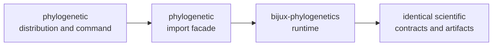

# phylogenetic

<!-- bijux-phylogenetics-badges:generated:start -->
[](https://pypi.org/project/phylogenetic/)
[](https://github.com/bijux/bijux-phylogenetics/blob/main/LICENSE)
[](https://github.com/bijux/bijux-phylogenetics/actions/workflows/verify.yml?query=branch%3Amain)
[](https://github.com/bijux/bijux-phylogenetics/actions/workflows/release-pypi.yml)
[](https://github.com/bijux/bijux-phylogenetics/actions/workflows/release-ghcr.yml)
[](https://github.com/bijux/bijux-phylogenetics/actions/workflows/release-github.yml)
[](https://github.com/bijux/bijux-phylogenetics/actions/workflows/deploy-docs.yml)

[](https://pypi.org/project/phylogenetic/)
[](https://pypi.org/project/bijux-phylogenetics/)

[](https://github.com/bijux/bijux-phylogenetics/pkgs/container/bijux-phylogenetics%2Fphylogenetic)
[](https://github.com/bijux/bijux-phylogenetics/pkgs/container/bijux-phylogenetics%2Fbijux-phylogenetics)

[](https://bijux.io/bijux-phylogenetics/01-bijux-phylogenetics/)
[](https://bijux.io/bijux-phylogenetics/01-bijux-phylogenetics/)
<!-- bijux-phylogenetics-badges:generated:end -->

`phylogenetic` is the short-name compatibility distribution for the complete
Bijux phylogenetics runtime. It depends on `bijux-phylogenetics` and exposes
the same workflow contract through `phylogenetic` import and command names.

It is not a fork, legacy edition, or reduced feature set.

## Installation

```bash
python -m pip install phylogenetic
phylogenetic --help
```

Python 3.11 or newer is required.

## Resolve Both Distribution Identities

The compatibility name and canonical runtime should be inspected together:

```python
from importlib.metadata import version

import bijux_phylogenetics
import phylogenetic

print("requested distribution:", version("phylogenetic"))
print("canonical distribution:", version("bijux-phylogenetics"))
print("alias import:", phylogenetic.__version__)
print("canonical import:", bijux_phylogenetics.__version__)
print("shared API facade:", phylogenetic.api is bijux_phylogenetics.api)
```

Record all four versions when reporting an installation problem. Local dirty
or editable builds can carry different local-version markers even when the
alias resolves to the intended canonical API; compare the installed artifacts
and runtime path before deciding whether the difference is a defect.

## Verify The Alias End To End

The compatibility command can run the same packaged demonstration:

```bash
phylogenetic demo run \
  --out artifacts/phylogenetic-capability-demo \
  --manifest artifacts/phylogenetic-capability-demo/manifest.json \
  --json
```

The command should report `status: ok` and write the same classes of input and
report artifacts as the canonical command. Record the resolved canonical
runtime version when reporting a defect; alias behavior is meaningful only in
relation to that runtime.

## Name Mapping

| Canonical | Compatibility name |
| --- | --- |
| distribution `bijux-phylogenetics` | distribution `phylogenetic` |
| `import bijux_phylogenetics` | `import phylogenetic` |
| `from bijux_phylogenetics.api import …` | `from phylogenetic.api import …` |
| command `bijux-phylogenetics` | command `phylogenetic` |

The scientific runtime, external-engine requirements, artifact semantics,
quality boundaries, and Evidence Book are shared.

## Workflow Example

```python
from pathlib import Path

from phylogenetic.api import (
    run_comparative_model_workflow,
    run_sequence_to_tree_workflow,
)

sequence_run = run_sequence_to_tree_workflow(
    Path("dataset/sequences.fasta"),
    out_dir=Path("artifacts/sequence-to-tree"),
    sequence_type="dna",
)

comparative_run = run_comparative_model_workflow(
    Path("dataset/tree.nwk"),
    Path("dataset/traits.tsv"),
    response="response",
    predictors=["predictor"],
    lambda_value=1.0,
)

sequence_run.write_json(Path("artifacts/sequence-to-tree/workflow.json"))
comparative_run.write_tsv(Path("artifacts/comparative-model.tsv"))
```

## Choosing A Distribution Name

Use `phylogenetic` when concise commands and imports are valuable. Use the
canonical `bijux-phylogenetics` name in publications, environment manifests,
release notes, and support reports when package identity should be explicit.

Installing both does not create independent runtimes. When diagnosing an
environment, record both the requested compatibility distribution and the
resolved canonical runtime version.

## Compatibility Contract

The alias is verified for import behavior, commands, version alignment,
package resources, examples, and built-artifact installation. Report a defect
when a documented canonical workflow cannot be expressed through the alias or
when metadata implies different scientific capability.



Compatibility covers naming, imports, commands, resources, and version
alignment. It does not create a second implementation, independent release
line, or separate evidence base. External-engine availability and scientific
limits remain identical under both names.

## Compatibility Failure Classes

| Failure | Meaning | Evidence to retain |
| --- | --- | --- |
| alias distribution missing | packaging or dependency resolution failed | installer output and environment package list |
| `import phylogenetic` fails while canonical import succeeds | facade packaging or import contract failed | traceback and both distribution versions |
| documented alias symbol is absent | public export correspondence failed | symbol path and canonical equivalent |
| alias command differs in parsing or exit state | CLI facade contract failed | commands, streams, exit codes, and structured outputs |
| packaged resource differs | distribution assembly contract failed | wheel hashes and resource inventories |
| numerical result differs after identical dispatch | canonical-runtime identity or serialization path must be investigated | full configurations, manifests, results, and loaded module paths |

Scientific disagreement is not an expected alias feature. The short name may
change how the runtime is requested, never the model, algorithm, or evidence
contract.

## Diagnose A Difference

1. Capture `phylogenetic --version` and `bijux-phylogenetics --version`.
2. Compare the resolved installed distributions in the same environment.
3. Run the smallest documented workflow through both command names.
4. Compare structured outputs and manifests before comparing HTML rendering.
5. Report divergent import, command, resource, metadata, or serialization
   behavior as an alias-contract defect.

Do not repair a difference by copying source into the alias package. The alias
must continue to delegate to the canonical implementation; duplicated runtime
code would create two scientific owners and make future evidence ambiguous.

## Documentation

- [Product handbook](https://bijux.io/bijux-phylogenetics/01-bijux-phylogenetics/)
- [Scientific domains](https://bijux.io/bijux-phylogenetics/02-bijux-phylogenetics-domains/)
- [Distribution map](https://bijux.io/bijux-phylogenetics/01-bijux-phylogenetics/architecture/package-map/)
- [Surface selection](https://bijux.io/bijux-phylogenetics/01-bijux-phylogenetics/interfaces/surface-selection/)
- [Workflow operations](https://bijux.io/bijux-phylogenetics/01-bijux-phylogenetics/operations/)
- [Artifact contracts](https://bijux.io/bijux-phylogenetics/01-bijux-phylogenetics/interfaces/artifact-contracts/)
- [Evidence Book](https://bijux.io/bijux-phylogenetics/03-bijux-phylogenetics-evidence-book/)
- [Canonical package source](https://github.com/bijux/bijux-phylogenetics/tree/main/packages/bijux-phylogenetics)

Apache License 2.0.
