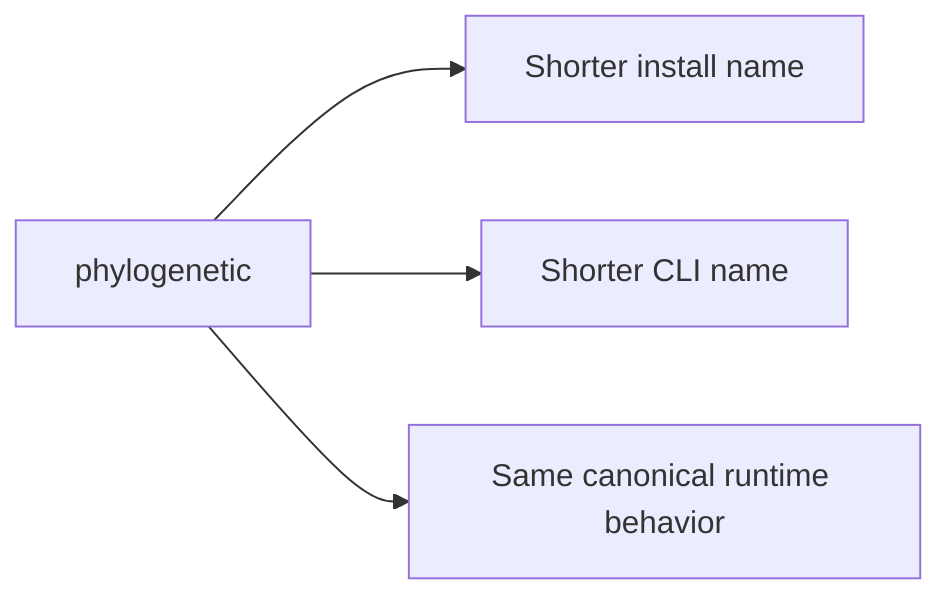

# phylogenetic

<!-- bijux-phylogenetics-badges:generated:start -->
[](https://pypi.org/project/phylogenetic/)
[](https://github.com/bijux/bijux-phylogenetics/blob/main/LICENSE)
[](https://github.com/bijux/bijux-phylogenetics/actions/workflows/verify.yml?query=branch%3Amain)
[](https://github.com/bijux/bijux-phylogenetics/actions/workflows/release-pypi.yml)
[](https://github.com/bijux/bijux-phylogenetics/actions/workflows/release-ghcr.yml)
[](https://github.com/bijux/bijux-phylogenetics/actions/workflows/release-github.yml)
[](https://github.com/bijux/bijux-phylogenetics/actions/workflows/deploy-docs.yml)

[](https://pypi.org/project/phylogenetic/)
[](https://pypi.org/project/bijux-phylogenetics/)

[](https://github.com/bijux/bijux-phylogenetics/pkgs/container/bijux-phylogenetics%2Fphylogenetic)
[](https://github.com/bijux/bijux-phylogenetics/pkgs/container/bijux-phylogenetics%2Fbijux-phylogenetics)

[](https://bijux.io/bijux-phylogenetics/phylogenetics/)
[](https://bijux.io/bijux-phylogenetics/phylogenetics/)
<!-- bijux-phylogenetics-badges:generated:end -->

Compatibility alias package for `bijux-phylogenetics`.

This distribution installs the canonical phylogenetics runtime under the
shorter `phylogenetic` package and CLI names. It is not a reduced runtime and
it is not a fork. It points at the same benchmark, workflow, and reporting
surfaces that the canonical package publishes.



## Install

`phylogenetic` supports Python 3.11 and newer.

```bash
python3.11 -m pip install phylogenetic
phylogenetic --help
```

## What You Still Get

Installing the alias package still gives you access to the same documented
runtime depth:

| Capability family | What carries through the alias |
| --- | --- |
| Trees and alignments | inspection, validation, comparison, and preparation workflows |
| Native runtime | native likelihood and native inference surfaces |
| Comparative analysis | comparative and ancestral workflows |
| Reporting | benchmark, workflow, and reporting surfaces |
| External engines | governed wrapper-backed external-engine workflows |

Choose this package when you want the shorter install and command names while
keeping the same public runtime contract.

Choose the canonical `bijux-phylogenetics` package instead when you want the
most explicit package name for notebooks, papers, release notes, or downstream
documentation.

## Read This Next

- [Runtime product guide](https://bijux.io/bijux-phylogenetics/phylogenetics/)
- [Runtime architecture](https://bijux.io/bijux-phylogenetics/phylogenetics/architecture/)
- [Surface selection guide](https://bijux.io/bijux-phylogenetics/phylogenetics/interfaces/surface-selection/)
- [Artifact consumption guide](https://bijux.io/bijux-phylogenetics/phylogenetics/interfaces/artifact-consumption-guide/)
- [Native Inference And Benchmark Surfaces](https://bijux.io/bijux-phylogenetics/phylogenetics/interfaces/native-inference-and-benchmarks/)
- [Native maximum-likelihood workflows](https://bijux.io/bijux-phylogenetics/phylogenetics/operations/native-maximum-likelihood-workflows/)
- [Native Bayesian workflows](https://bijux.io/bijux-phylogenetics/phylogenetics/operations/native-bayesian-workflows/)
- [Native benchmark review](https://bijux.io/bijux-phylogenetics/phylogenetics/operations/native-benchmark-review/)
- [Release review workflow](https://bijux.io/bijux-phylogenetics/phylogenetics/quality/release-review-workflow/)
- [Evidence-book guide](https://bijux.io/bijux-phylogenetics/phylogenetics-evidence-book/)
- [Canonical runtime package on GitHub](https://github.com/bijux/bijux-phylogenetics/tree/main/packages/bijux-phylogenetics)
